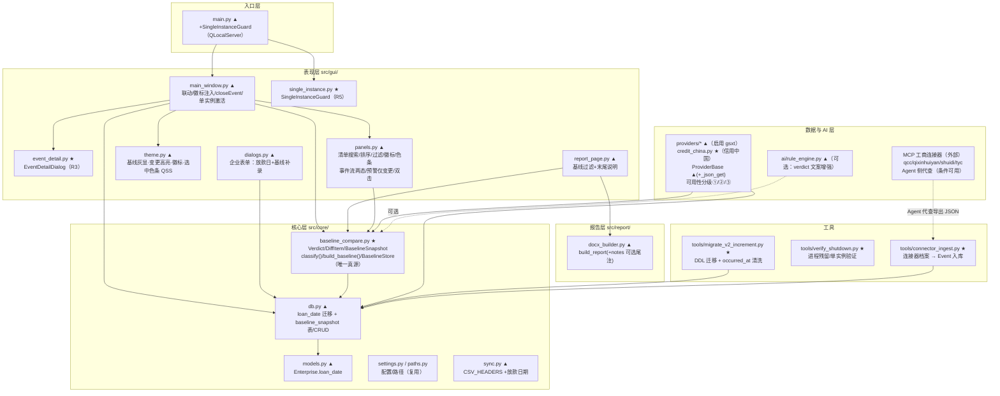
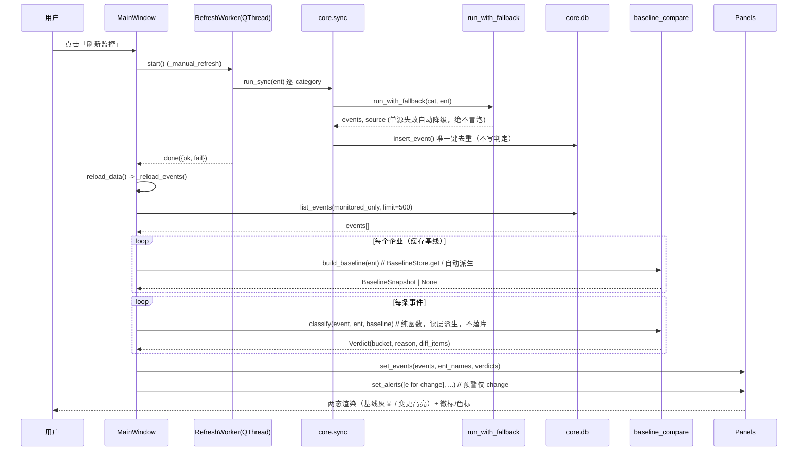
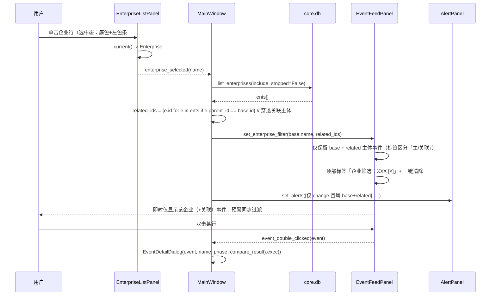
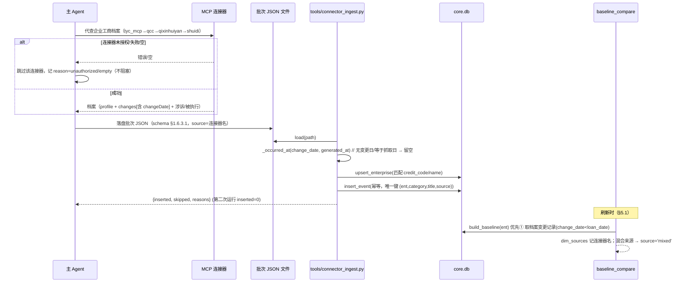
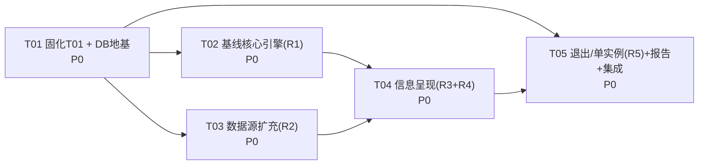

# BankRiskMonitor v2 增量升级 · 系统架构设计 + 任务分解（R1–R5）

> 文档类型：增量系统架构设计（Increment SAD）· 版本：**v1.2** · 状态：**已定稿**（用户已确认启用连接器）
> 编制：高见远（架构师） · 上游输入：`docs/PRD-v2-increment.md`（v1.1，许清楚）、`docs/ARCH-v2.md`（上一轮主设计）
> **v1.1 变更摘要：按主理人联网实测纠正 R2 数据源——jisuapi 免费不含工商（降级为付费候选）、tianapi 有工商接口但非免费（800 天豆/次、默认 disabled）、引入数据源"三级可用性等级"（§1.6.1）与"连接器代查补充通路"（§1.6.3）。**
> **v1.2 变更摘要：用户已拍板"本轮启用并接入 4 个工商连接器"（qcc-company / qixinhuiyan-mcp / shuidi-credit / tyc-mcp）；补实 `tools/connector_ingest.py` 输入 JSON schema、`changeDate→occurred_at` 硬约束、连接器→放款前基线衔接、4 连接器优先级与降级、T03 验收补充；U4 连接器部分移入「§9 已确认决策记录」。**
> 目标读者：可直接施工的工程师。文中类名 / 文件路径 / 函数签名 / DDL / 迁移片段均可直接落码。
> **本文只描述本次 R1–R5 增量，不改写既有分层与对外契约。**
> 术语与既有决策延续 `ARCH-v2.md`（`ProviderBase` / `run_with_fallback` / `theme` tokens / `core.paths` / `db.connect` 短连接 / 缺省"零伪造"）。

---

## 0. 结论速览（TL;DR）

| 诉求 | 架构落点 | 关键决策（详见 §1） |
|---|---|---|
| **R1** 放款前基线 + 放款后差异对比 | 新增 `src/core/baseline_compare.py`（**全系统唯一真源**）；`enterprise.loan_date` 幂等迁移；新增 `baseline_snapshot` 表 | 基线**结构化列（独立表）**而非 JSON；`classify()` **纯函数可单测**；判定**读层派生不落库**；`occurred_at` 语义规范 + 存量清洗 |
| **R2** 数据源扩充（仅免费/官方） | `config.yaml` + `src/providers/*`（启用 gsxt、新增信用中国适配器）+ **连接器代查补充通路** | **三级可用性分级**（确定可用/条件可用/尽力而为）+ **API 优先 + 优雅降级**，源失败绝不阻塞、UI 体现"该源不可用"；**复用现有 category**（零契约迁移）；付费源（juhe/tianapi **含 jisuapi**/commercial）一律 `enabled:false` 仅留 Key 位 |
| **R3** 信息详情弹窗 | 新增 `src/gui/event_detail.py` 单一 `EventDetailDialog` | 两入口（事件流/预警）双击复用同一组件；`QDesktopServices.openUrl` |
| **R4** 工作台易用性 | `panels.py` + `main_window.py` + `theme.py` | 左侧点击 → 右侧即时筛选（含穿透关联）；事件流「基线灰显 / 变更高亮」两态；预警仅 change |
| **R5** 进程残留 + 单实例 | `main_window.closeEvent` + `main.py` + `src/gui/single_instance.py` | 单实例选型 **QLocalServer/QLocalSocket**（非 QSharedMemory）；线程 `requestInterruption()+wait()+terminate()` 兜底 |

**任务分解**：5 个任务（T01–T05，≤5 硬约束）。**T01＝固化上一轮 T01（打包验证 + git 提交）+ 本次地基（DB 迁移骨架）**；其余按「基线内核 → 数据源 → 信息呈现 → 退出/集成」依赖排序。

---

## 1. 增量实现方案与关键技术决策

### 1.1 现状锚点（已核实，设计与施工以此为基）

| 维度 | 现状 |
|---|---|
| 数据库 | `src/core/db.py`（204 行）SQLite（WAL）；`enterprise/event/credit_material/app_settings/ai_queue` 五表；**`init_db()` 仅 `CREATE TABLE IF NOT EXISTS`，无迁移机制**；`enterprise` **无 `loan_date`** |
| 存疑数据（病根） | `data/monitor.db` 中 `source='tianyancha_mcp'` 共 **7 行**（7 家监控企业各 1 行），`category='biz_change'`，标题 `<企业名>：工商档案核验（天眼查）`，`occurred_at` **全被写成入库日 `2026-10-13`**、`created_at='2026-10-13 16:26:16'`，摘要**只有登记状态/法定代表人/注册资本/实缴/参保/风险标签，无变更日期** |
| 真实监控主体 | 7 家（id 13–19，均落 辽宁省/抚顺市）；**放款日**：鑫泰(19)/民泰(16)=`2026-09-29`；开投(15)=`2026-10-10`；其余未知 |
| 其他源存量 | `baidu_news`(20)、`court_announce`(13)、`qcc_api`(25)、`wechat_sogou`(17)、`weibo`(7)；`court_announce/qcc_api` 为**数据中已存在但未登记进 config** 的源，其 `occurred_at` 为**真实日期**（2026-08-14 … 2026-10-12，可放心） |
| 研判 | `src/ai/rule_engine.py#assess_by_rule` 返回 `{sentiment,severity,relevance,verdict}`，`biz_change` 命中 `_EQUITY_WORDS` 即 medium/high，**完全不看时间** |
| GUI | `main_window.py` 工具栏 8 动作 + `QSplitter(H)`【企业清单≤340｜地图｜`QSplitter(V)`【事件流｜预警】】+ `AISummaryPanel` + 状态栏 + 1s `_tick_timer`；**无 `closeEvent`** |
| Provider 框架 | `base.py`：`ProviderBase`（`fetch(ent)->List[Event]`、`http_get` 带节流/代理/UA）、`load_providers(category)`、`run_with_fallback(category, ent)`（**内部已 try/except 全兜底**） |
| 连接器通路（现状） | 本机 WorkBuddy 已装 4 个工商查询连接器 `qcc-company`/`qixinhuiyan-mcp`/`shuidi-credit`/`tyc-mcp`（**当前均 disabled，用户已确认本轮启用并接入**——见 §9 C5）；上一轮真实档案即经连接器代查注入（`source=tianyancha_mcp` 共 7 行）。通路契约见 §1.6.3 |
| 报告（重要差异） | **`src/report/` 仅有 `docx_builder.py`（6 章：overview/events/ai/penetration/alerts/advice）与 `__init__.py`；`postloan.py` 与报告引擎（ARCH-v2 T02–T05）从未实现**；当前报告路径 = `report_page.py → docx_builder.build_report()` |

### 1.2 决策 A：基线快照的存储形态 —— **独立结构化表（`baseline_snapshot`），而非 JSON 载荷、不污染 `enterprise`**

| 方案 | 取舍 |
|---|---|
| **① 结构化列（采用）** | 11 个对比维度**逐列建表**（可空=该维基线缺失），**可 SQL 查询、强类型、可单测、可肉眼核对**；`source/dim_sources` 记录来源与优先级降级链 |
| ② 单列 JSON 载荷 | 查询/核对困难、类型漂移、迁移痛苦，且与既有结构化风格不符 → **弃用** |
| ③ 直接加列到 `enterprise` | 每维列会污染主表、随 loan_date 变更需频繁重建；主表语义被稀释 → **仅 `loan_date` 落 `enterprise`**（它是企业第一性属性，进清单/表单/导入导出），**其余基线维度落独立表** |

**结论**：`enterprise` 只加一个 `loan_date` 列；基线 11 维放新表 `baseline_snapshot`（`enterprise_id` 唯一，一企业一行，可随 `loan_date` 变化幂等重建）。**用户手动补录**直接写该表并置 `source='manual'`，无需另建补录表（最小变更）。

### 1.3 决策 B：判定函数的纯度与可测性 —— **`baseline_compare.py` 为全系统唯一真源，`classify()` 无 IO、纯函数**

- 单一真源使用方：事件流标签、预警筛选、企业清单徽标计数、「基线/历史」视图、详情弹窗、报告映射。**任何一处不得另写比较逻辑。**
- `classify(event, ent, baseline) -> Verdict` **只做纯字符串/日期运算，不查库、不发网**；查库由 `BaselineStore` / `build_baseline()` 完成，判定与取数解耦 → 100% 可单测（无需 DB/网络）。
- **判定结果不落库**（PRD §3.8 硬约束）：**不新增 `event` 列**，`event.severity` 不被污染 → 可回退、可单测。`loan_phase` / `verdict` 在**读取层派生**并随 view-model 缓存。

### 1.4 决策 C：`occurred_at` 语义规范 + 存量清洗

**语义规范（冻结，写入共享知识）**：
> `event.occurred_at` **≡ 事件"实际发生/变更"日期**（`YYYY-MM-DD`）。**取不到 → 空串**（表示日期未知，走 `undetermined`）。**严禁写入抓取/入库日**。

**存量清洗策略**（`tools/migrate_v2_increment.py`，幂等、可 `--dry-run`）：
1. **识别被污染行**：`SELECT id FROM event WHERE source='tianyancha_mcp'`（该源即"档案核验快照"，本身不含变更日期）——本库命中 **7 行**；辅以佐证：`occurred_at == created_at[:10]`（`2026-10-13`）且标题含 `工商档案核验`。
2. **清洗动作**：`UPDATE event SET occurred_at='' WHERE source='tianyancha_mcp' AND occurred_at=created_at[:10]` → 清空为"日期未知"。理由：档案快照无变更日，按新语义应"留空"，判定落 `undetermined`（**不自动判为非问题**，进「待核实·按现状披露」）。
3. **备份**：先 `shutil.copy2(db_path, db_path + ".bak-v2inc-<YYYYmmdd_HHMMSS>")`（与本库既有 `monitor.db.bak-filter-20261013` 命名一致）；`--dry-run` 只打印将改行数不落库。
4. **防复发**：注入路径（MCP 档案 → 事件）一律不写 `occurred_at`（无变更日则留空）；并在 `sync._in_lookback` 之外新增"日期未知不判"的读层语义（既有 `_in_lookback` 对空日期本就保留，无需改）。
5. **只读旁证**：`qcc_api` / `court_announce` 的 `occurred_at` 为真实日期，**不清洗**。

### 1.5 决策 D：单实例锁选型 —— **QLocalServer + QLocalSocket（非 QSharedMemory）**

| 维度 | QSharedMemory | **QLocalServer/QLocalSocket（采用）** |
|---|---|---|
| Windows 底层 | 共享内存段 | **命名管道（named pipe），OS 管理生命周期** |
| 崩溃残留 | 段可能残留，需 `attach/detach` 小心处理，易误判 | 崩溃后 OS 自动释放，**无残留** |
| 第二实例"激活已有窗口" | 不支持，需额外 IPC | **原生支持**：第二实例连管道 → 发 `SHOW` → 主实例 `activated` 信号抬窗 |
| 依赖 | `QtCore` | `QtNetwork`（spec **未 exclude**，见 §7） |

**结论**：`src/gui/single_instance.py` 提供 `SingleInstanceGuard(key="BankRiskMonitor")`：`is_primary()`（尝试 `QLocalSocket.connectToServer` 失败即新建 `QLocalServer.listen`）、`notify_existing()`（连上后写 `b"SHOW"`）、`activated = Signal()`（server `newConnection` → 读 `SHOW` → emit）。`main.py` 集成：非主实例 → `notify_existing()` 后 `sys.exit(0)`；主实例把 `activated` 连到 `win.showNormal(); win.raise_(); win.activateWindow()`。

### 1.6 决策 E：数据源分级 + "API 优先 + 优雅降级" + 连接器代查补充通路

> **⚠ 数据源调研已由主理人联网实测纠正**（见本节表）：极速数据 jisuapi **不含免费工商/司法接口**（其免费清单仅归属地/IP/汇率/黄历等），工商类属**付费**；天聚数行 tianapi **有工商接口但非免费**（`https://www.tianapi.com/apiview/272`，计费 **800 天豆/次**，注册赠豆/申请赠量，支持 MCP）。**真实零成本源只有"官方公开源 + 已有免费/限次 API"两类。**

#### 1.6.1 数据源"可用性等级"（三级，冻结）

| 等级 | 定义 | `config.yaml` 默认 `enabled` | UI 提示文案 |
|---|---|---|---|
| **① 确定可用** | 无需 Key 的官方/公开源，理论上稳定但政务站点仍可能反爬 | `true`（可开关） | 正常；失败时状态栏显示"源不可用" |
| **② 条件可用** | **需 Key**（免费额度/赠豆）或**需 Cookie** 或**限次** | **`false`**（仅留 Key/配置位，用户填 Key 后才开） | "未配置 Key，已跳过" / "免费额度耗尽" |
| **③ 尽力而为** | 反爬站点，页面采集**可能失败** | `true`（可开关，允许失败） | "该源当前不可用（反爬/网络）" |

**硬性约定**：任一源失败 **绝不阻塞刷新、绝不抛未捕获异常**（`run_with_fallback` 逐源兜底）；**失败须在 UI 可见**（状态栏"数据源 X/Y 启用 · Z 可用"，或刷新结束 `error` 计数）。

#### 1.6.2 数据源清单（修正后）

| 来源 | category | 等级 | 接入方式 | Key/Cookie | 本轮策略 |
|---|---|---|---|---|---|
| 国家企业信用信息公示系统 gsxt.gov.cn | biz_change（经营异常/行政处罚/变更记录） | **① 确定可用** | 页面采集（已存 `biz_gsxt`，现 `enabled:false`） | 否 | **启用并验证**；带日期变更记录是 R1 基线首选 |
| 信用中国 creditchina.gov.cn | enforcement（行政处罚/失信/重大税收违法失信） | **① 确定可用** | 公开接口/页面（端点运行时核实） | 否 | 新增 `credit_china.py`；端点核实后可开 |
| 中国执行信息公开网 zxgk.court.gov.cn | enforcement | **① 确定可用** | 已存适配器 | 否 | 保持启用 |
| 中国裁判文书网 wenshu.court.gov.cn | lawsuit | **① 确定可用** | 已存适配器 | 否 | 保持启用（加"结果为空"降级） |
| 中国招标投标公共服务平台 / 中国政府采购网 | news | **③ 尽力而为** | 页面采集 | 待核实 | P2 后置 |
| 国家知识产权局（专利商标） | news | **③ 尽力而为** | 页面采集 | 待核实 | P2 后置 |
| 爱企查 aiqicha.baidu.com | biz_change（变更沿革/股东） | **② 条件可用** | 网页采集（已存，可配 Cookie） | 可选 Cookie | 保持启用；**带日期变更记录，R1 基线来源之一** |
| ApiZero（极数本源） | biz_change | **② 条件可用（限次 5~10/日）** | API（已存 `biz_apizero`） | 否/可选 | 保持启用，仅兜底 |
| 天聚数行 tianapi.com（**工商查询 272**） | biz_change | **② 条件可用（需 Key，800 天豆/次，赠额度）** | API，**支持 MCP** | **是** | **默认 `enabled:false`，仅留 Key 位** |
| 聚合数据 juhe.cn | biz_change | **② 条件可用（付费）** | 商业 API（已存 `biz_juhe`） | 是 | **默认 `enabled:false`，仅留 Key 位** |
| 极速数据 jisuapi.com | — | **② 条件可用（付费）** | 付费 API | 是 | **免费不含工商；默认 `enabled:false`，仅留 Key 位（若引入）** |
| 天眼查开放平台 / 企查查开放平台 / 商业舆情 | 六类 | **② 条件可用（付费）** | 商业 API（已存 `biz_commercial`） | 是 | **默认 `enabled:false`，仅留 Key 位** |
| 省级税务局欠税公告（先做辽宁） | enforcement | **③ 尽力而为** | 页面采集（分散，逐省适配） | 否 | P1；端点待核实 |

> **六类覆盖结论**（仅用 ①/②/③ 中免费项）：股权变更＝gsxt/爱企查；涉诉＝wenshu；被执行＝zxgk；行政处罚＝gsxt/信用中国；欠税＝信用中国（重大税收违法失信）；经营异常＝gsxt。**付费源不阻塞 P0。**

#### 1.6.3 连接器代查补充通路（**★ 用户已确认：本轮启用并接入**）

本机 WorkBuddy 已装 4 个工商查询连接器：`qcc-company`（企查查）、`qixinhuiyan-mcp`（启信慧眼）、`shuidi-credit`（水滴信用）、`tyc-mcp`（天眼查）。**用户已拍板本轮启用并接入**（用户自行在 WorkBuddy 左下角「+」菜单开启授权）。上一轮真实企业档案正是**经连接器代查后注入监测库**（`source=tianyancha_mcp`）。本方案将其**制度化为一条正式补充通路**，不替代 `providers/*`，而是**复用同一入库/判管道**。

**通路形态**：`主 Agent 通过 MCP 连接器代查企业档案 → 落成 JSON 文件 → tools/connector_ingest.py 归一化 → insert_event(monitor.db)`。脚本为**离线 CLI**，不改 GUI 主流程；亦可由 Agent 会话直接调用。

##### 1.6.3.1 `tools/connector_ingest.py` 输入 JSON schema（**冻结契约**）

顶层为一个**代查批次对象**；`companies` 为逐企业结果数组。字段命名**以本 schema 为准**（连接器原始返回由主 Agent 归一后按此落盘）：

```jsonc
{
  "schema_version": "1.0",            // 必填
  "generated_at": "2026-10-16T14:30:00", // 必填：本批次代查时间（ISO，仅用于溯源，绝不写入 occurred_at）
  "connector": "tyc_mcp",             // 必填：连接器标识（见下方命名规范）
  "companies": [
    {
      "name": "辽宁省沈抚示范区鑫泰房地产开发有限公司",  // 必填：企业名（用于匹配 enterprise）
      "credit_code": "91211500MACJ4PXF9C",             // 选填：统一社会信用代码（优先用它精确匹配）
      "profile": {                     // 选填：工商登记项（"当前状态"快照，供基线/对比维度）
        "legal_person": "张三",        // 法定代表人
        "reg_capital": "3000万人民币", // 注册资本（原文，含单位）
        "shareholders": [ {"name": "李四", "ratio": "60%"}, {"name": "王五", "ratio": "40%"} ],
        "business_scope": "房地产开发；物业管理…", // 经营范围
        "business_status": "存续",     // 经营状态
        "abnormal": false,             // 是否列入经营异常名录
        "tax_status": "",              // 税务状态（欠税/非正常户/重大税收违法），取不到留空
        "risk_tags": ["失信", "经营异常"] // 风险标签集合
      },
      "changes": [                     // 选填：变更记录数组（**R1 基线首选来源**）
        {
          "change_item": "法定代表人",  // 变更事项（映射 11 维）
          "before": "张三",             // 变更前
          "after": "赵六",              // 变更后
          "change_date": "2026-10-05"   // 变更日期（YYYY-MM-DD）；**取不到则空串**
        }
      ],
      "lawsuits": [                    // 选填：涉诉记录（→ category=lawsuit）
        {"title": "合同纠纷", "amount": "120万", "case_no": "(2026)辽01民初123号", "date": "2026-09-20"}
      ],
      "enforcements": [                // 选填：被执行/失信/限高（→ category=enforcement）
        {"title": "被执行人", "case_no": "(2026)辽01执456号", "date": "2026-10-01"}
      ],
      "url": "https://www.tianyancha.com/company/123456"  // 选填：源详情页
    }
  ]
}
```

| 字段 | 必填 | 说明 |
|---|---|---|
| `schema_version` / `generated_at` / `connector` | ✅ | 批次元信息；`generated_at` **仅供溯源，禁止入 `occurred_at`** |
| `companies[].name` | ✅ | 企业名；匹配顺序 `credit_code` 精确 → `name`（同名多主体时以 `credit_code` 为准） |
| `companies[].credit_code` | ⬜ | 统一社会信用代码，可选但强烈建议 |
| `profile.*` | ⬜ | 工商登记项快照：`legal_person/reg_capital/shareholders/business_scope/business_status/abnormal/tax_status/risk_tags` |
| `changes[].change_item/before/after` | ✅（change 项内） | 映射 11 维；`change_item` 按关键词归一（见 §附录 B） |
| `changes[].change_date` | ⬜ | **变更日期**；有则入 `occurred_at`，无则空串 |
| `lawsuits[]` / `enforcements[]` | ⬜ | 逐条生成 `lawsuit`/`enforcement` 事件 |
| `url` | ⬜ | 详情页链接 |

**`source` 命名规范（冻结）**：批次 `connector` 值 → 入库事件的 `source`，取值仅限：`tyc_mcp` / `qcc_company` / `qixinhuiyan_mcp` / `shuidi_credit`（与 `providers/*` 的 `name` 同一筛选口径）。未知值 → 记 `connector_unknown` 并 `log.warning`，**不阻断**。

##### 1.6.3.2 `changeDate → occurred_at` 映射硬约束（**严禁抓取日**）

> 这正是 `tianyancha_mcp` 7 行污染的病根（§1.4）。**任何情况下都不得把 `generated_at`（代查/抓取日）写入 `occurred_at`。**

**判定与兜底（可直接落码）**：

```python
def _norm_date(v) -> str:
    """归一为 'YYYY-MM-DD'；任何无法解析的值（None/''/抓取日外的脏值）-> ''。"""
    s = str(v or "").strip()[:10]
    if len(s) == 10 and s[4] == "-" and s[7] == "-" and s.replace("-", "").isdigit():
        return s
    return ""

def _occurred_at(change_date, *, generated_at: str) -> tuple[str, str]:
    """返回 (occurred_at, date_note)。硬约束：绝不回退到 generated_at。"""
    d = _norm_date(change_date)
    if d and d != _norm_date(generated_at):   # 即便显式给了，也拒绝等于抓取日
        return d, ""
    return "", "（变更日期缺失，来源档案未提供变更日）"   # 留空 + 摘要标注
```

- **有变更日** → `occurred_at = 变更日`；
- **无变更日** → `occurred_at = ""`（空串），并在 `summary` 末尾追加 `"（变更日期缺失，来源档案未提供变更日）"`；
- **防御**：即使 `change_date` 恰好等于 `generated_at`，也判为不可信 → 留空（防上游把抓取日当变更日传下来）；
- 读层：`occurred_at=""` 的事件在 `classify` 中落 `undetermined`（"事件日期未知"），**不自动判为非问题**（§5.1 判定顺序 step 2）。

##### 1.6.3.3 幂等与去重（同一企业多次代查）

- **匹配既有企业**：`credit_code` 精确 → 否则 `name`；均未命中则 `upsert_enterprise(name, credit_code)` 新建（`monitored` 默认沿用；关联主体不新建，见降级）。
- **事件去重复用** `event` 表唯一键 `(enterprise_id, category, title, source)`。**`title` 构造规则（稳定去重 + 可读）**：
  - 变更项：`f"{ent_name}：{change_item}由{before}变更为{after}"` —— **不含日期**，故同一变更重复代查**幂等去重**（`insert_event` 返回 `False`）；
  - 无 `change_item` 但有 `after`：`f"{ent_name}：{change_item or '工商变更'}：{after}"`；
  - 涉诉：`f"{ent_name}：涉诉 {case_no or title}"`；被执行：`f"{ent_name}：{title} {case_no}"`。
  - **变更日期只进 `occurred_at`（与摘要），不进 title** —— 否则每次日期微调都会绕过唯一键产生重复行。
- **`source` 参与唯一键**：同一变更若由两个连接器代查，会因 `source` 不同各留一行（可接受，便于溯源）；如需跨源去重，交给人工/AI 研判合并（本轮不做）。
- **重复执行**：脚本对同一样例 JSON 反复运行 → 第二次起 `insert_event` 全部去重，`inserted=0`（**幂等**）。

##### 1.6.3.4 四连接器接入优先级与降级（**不阻塞、记原因**）

- **优先级（`config.yaml` 声明顺序，可调）**：`tyc_mcp` → `qcc_company` → `qixinhuiyan_mcp` → `shuidi_credit`（天眼查→企查查→启信慧眼→水滴信用）。运行批次里每个企业**按序尝试**，取**首个成功返回**的连接器；若要**多源合并**可配 `merge: true`（默认 false = 首成功即止）。
- **降级**：某连接器**未授权 / 未启用 / 查询失败 / 返回空** → **优雅跳过**下一个：写入 `data/logs/connector_<ts>.log` 记录 `{connector, company, reason}`，并累计到状态（**绝不抛异常、绝不阻塞**）。四者皆失败 → 该企业本批次无连接器数据，`log.warning`，主流程继续。
- **未授权识别**：连接器调用返回鉴权错误（如 `401/403/无权限`）或抛出未启用异常 → 归入 `reason="unauthorized"` 跳过；**不重试、不弹窗**。
- **落点**：主 Agent 侧调用连接器（MCP 工具），`connector_ingest.py` 只消费已落盘的 JSON；因此**"连接器不可用"表现为该批次 JSON 缺该企业/该字段**，脚本对缺失字段一律按"可选、留空"处理。

##### 1.6.3.5 连接器档案 → 放款前基线的衔接（`build_baseline` 如何消费）

- **消费维度**：`profile.*` 与 `changes[]` 中**带 `change_date` 且 `< loan_date`** 的记录，供 `build_baseline` 解析出 11 维基线值：`legal_person`、`reg_capital`、`shareholders`、`business_scope`、`business_status`、`abnormal_flag`、`penalty_count`、`lawsuit_count`、`enforcement_status`、`tax_status`、`risk_tags`。
- **来源优先级**：连接器档案属 **`build_baseline` 优先级 ①**（带日期变更记录，与 gsxt/爱企查同级，由 `config.yaml` 顺序决定谁先）。
- **`dim_sources` 记连接器名**：由连接器提供的维度，`baseline_snapshot.dim_sources` 记 `{"legal_person": "tyc_mcp", "reg_capital": "tyc_mcp", ...}`（**记具体连接器名**，可溯源到是哪家代查的）。
- **`source='mixed'` 场景**：当**部分维度**来自连接器（①）、**部分维度**来自用户手动补录（②）或放款前历史事件（③）时，快照整体 `source='mixed'`，逐维来源见 `dim_sources`。单一只源时 `source` 取该源（如 `tyc_mcp`）。
- **降级链不变**：连接器缺失的维度 → 自动降到 ②手动补录 / ③放款前已采集历史事件；三维皆无 → 该维留 `NULL`（"基线缺失"）。

#### 1.6.4 Provider 统一契约（承接决策 E）
- **优先 API 形态**（结构化 JSON），**页面采集仅作兜底**；政务站点反爬强（gsxt JS 挑战+滑验、裁判文书 403、执行信息 412），**任何触网/解析失败一律抛 `RuntimeError` 交由 `run_with_fallback` 接管**（该函数已逐源 try/except，单源失败不影响其他源，**绝不冒泡到 GUI**）。
- 新增 `ProviderBase.fetch()` 统一契约：`_json_get(url, **kw) -> dict`（复用 `http_get` 的节流/代理/UA/超时）；解析失败返回 `[]` 或 raise（二者皆被 fallback 兜住）；**绝不在 `fetch` 内阻塞式重试导致卡死**（超时由 `network.timeout_seconds` 约束）。
- **category 复用**（零契约迁移）：`行政处罚/欠税(重大税收违法失信)/被执行失信 → enforcement`；`经营异常/其他工商变更 → biz_change`；`涉诉 → lawsuit`。**不改 `CATEGORIES` 元组**（避免地图图例/筛选/报告连锁改动）。可选增强：把 `CATEGORY_LABELS["enforcement"]` 文案由"被执行/查封"扩为"被执行/处罚"（标签级改动，无契约破坏）。

### 1.7 报告映射（R1）—— 最小变更落点

PRD R1 提及"`report/postloan.py` 第②/⑦章映射"，但**该模块不存在**（见 §1.1）。最小变更落点：对齐**现有报告路径**——"授信风险分析/显著风险" ≈ 现有 `alerts`(预警汇总) + `advice`(处置建议) 章节。做法：
1. `report_page._export()` 对每条事件取 `verdict = classify(...)`；**`alerts`/处置建议只纳入 `change`（放款后·变更）事件**（放款前·基线不计入显著风险）。
2. `docx_builder.build_report(..., notes: str = "")` 新增**可选**尾注参数（默认 `""`，**签名向后兼容**），渲染「附：基线说明」段落（逐企业列出基线来源 + 对比期区间 + 无法对比项）。
3. 完整 8 章贷后报告引擎重建**超出本轮范围**（ARCH-v2 T02–T05 未执行），列入待明确。

---

## 2. 架构分层图（Mermaid） + 文件清单

### 2.1 增量分层图（新增/改动以 ★新 / ▲改 标注）



### 2.2 文件清单

#### 新增（★）

| 相对路径 | 一句话职责 |
|---|---|
| `src/core/baseline_compare.py` | **全系统唯一真源**：`BaselineSnapshot`/`DiffItem`/`Verdict` 数据类、三态常量与文案、`parse_date`/`date_ge`、`dimension_of(event)`、`build_baseline(ent)->BaselineSnapshot\|None`、`classify(event, ent, baseline)->Verdict`、`BaselineStore`（薄封装 `db`）。**纯函数优先，可单测。** |
| `src/gui/event_detail.py` | `EventDetailDialog(event, ent_name, loan_phase, compare_result)`：≥12 字段只读详情弹窗；原文「复制」+`QDesktopServices.openUrl`；「筛选该企业事件」复用 R4 联动。 |
| `src/gui/single_instance.py` | `SingleInstanceGuard`：`QLocalServer/QLocalSocket` 单实例；`is_primary()`/`notify_existing()`/`activated` 信号（R5）。 |
| `src/providers/credit_china.py` | 信用中国适配器 `CreditChinaProvider(ProviderBase)`：行政处罚/失信/重大税收违法失信 → `enforcement`（等级① 确定可用）；**端点运行时核实**，失败优雅降级。 |
| `tools/migrate_v2_increment.py` | 幂等迁移（`loan_date` 列 + `baseline_snapshot` 表）+ `tianyancha_mcp` 存量 `occurred_at` 清洗；`--dry-run`/`--backup`。 |
| `tools/connector_ingest.py` | **连接器代查补充通路**（§1.6.3）：读连接器导出的工商档案 JSON（**冻结 schema 见 §1.6.3.1**）→ 归一为 `Event`（`occurred_at=变更日`、无变更日留空；`source=<连接器名>`）→ `insert_event` 幂等入库；供 R1 基线的"带日期变更记录"来源①。离线 CLI（`--file/--dry-run`），不改 GUI 主流程。 |
| `tools/verify_shutdown.py` | R5 验证：启动→关闭后断言无 `BankRiskMonitor.exe`/`QtWebEngineProcess.exe` 残留；双击启动断言单实例。 |
| `tests/test_baseline.py` | R1 判定矩阵 N1–N4、边界（`change_date==loan_date`）、11 维度变更/无变化、脏日期兜底。 |
| `tests/test_single_instance.py` | R5 单实例守卫 + `closeEvent` 线程回收冒烟。 |
| `tests/test_connector_ingest.py` | 连接器入库单测（**T03 验收**）：①样例 JSON 幂等可重复执行（第二次 `inserted=0`）；②`occurred_at` 无变更日为空 / 有变更日为真实日期 / **等于抓取日亦留空**；③未授权连接器（缺字段/鉴权失败）不抛异常、优雅跳过；④title 稳定去重。 |
| `docs/class-diagram-increment.mermaid` / `docs/sequence-diagram-increment.mermaid` | 本次增量类图 / 时序图（可独立渲染）。 |

#### 修改（▲）

| 相对路径 | 改动要点 |
|---|---|
| `src/core/models.py` | **仅新增** `Enterprise.loan_date: str = ""`（其余字段/契约不动）。 |
| `src/core/db.py` | `SCHEMA` 的 `enterprise` 增 `loan_date`；新增 `_ensure_column()` 幂等列迁移；新增 `baseline_snapshot` 表 DDL + `get_baseline/upsert_baseline/list_baselines`；`upsert_enterprise` INSERT 增 `loan_date`。 |
| `src/core/sync.py` | `CSV_HEADERS` 增「放款日期」；`import/export_...csv/xlsx` 同步支持 `loan_date`（缺失列容错为空）。 |
| `src/gui/dialogs.py` | `EnterpriseDialog` 增「放款日期」`QLineEdit`（占位 `YYYY-MM-DD`，校验 `^\d{4}-\d{2}-\d{2}$`）+「基线补录」折叠区（法定代表人/注册资本/股东数/涉诉数/被执行状态，选填）→ 写 `baseline_snapshot(source='manual')`。 |
| `src/gui/panels.py` | `EnterpriseListPanel`：搜索框/排序下拉/过滤下拉/`[高N]` 徽标/风险色标/选中色条；`EventFeedPanel`：两态渲染 + `event_double_clicked` 信号；`AlertPanel`：`alert_double_clicked` 信号 + 仅展示 change。 |
| `src/gui/main_window.py` | 注入 `risk_map`/徽标数据；`_reload_events` 按 `verdict` 过滤（预警仅 change）；右栏改 `QTabWidget`；`closeEvent`（停定时器 + 回收线程）；`SingleInstanceGuard.activated` 抬窗槽。 |
| `src/gui/theme.py` | 新增 QSS：`.row-baseline`（灰显降饱和 `TEXT_SECOND`）/`.row-change`（高亮 `TEXT_MAIN`）、`QLabel[badge=high|medium|low|none]`、清单选中左色条 `#00FF9C`、详情弹窗样式。 |
| `src/gui/report_page.py` | `_export` 按 `classify` 拆分事件；`alerts`/处置建议仅 `change`；调 `build_report(..., notes=基线说明)`。 |
| `src/report/docx_builder.py` | `build_report()` **新增可选参数 `notes: str = ""`**（默认不改行为），在章节后渲染「附：基线说明」。 |
| `main.py` | 集成 `SingleInstanceGuard`（非主实例激活已有窗口后退出）。 |
| `config.yaml` + `src/core/settings.py`（`DEFAULT_CONFIG_YAML`） | 启用 `gsxt`（等级①）；新增 `credit_china`（等级①，端点核实后可开）；**付费/需 Key 源（juhe、**tianapi 工商 272**、**jisuapi**、commercial）一律 `enabled:false` 仅留 Key 位**；`tianapi` 可标注 `supports_mcp:true`。**两处默认配置须保持一致**（`test_boot` 校验 `sources` 四类）。 |
| `BankRiskMonitor.spec` / `build_exe.bat` / `tools/verify_package.py` / `tests/{test_map_geo,test_gui_social,test_gui_settings}.py` | **T01 固化**：跑 PyInstaller 构建 + `verify_package.py` ≤80MB + 提交（当前工作区脏、未验证）。 |
| `tests/test_providers.py` | 新增：新源降级用例；**修正 CSV 往返断言**（`CSV_HEADERS` 增「放款日期」后 `rows[0]` 与 `rows[1]` 会变，见 §5.4）。 |
| `tests/test_gui_settings.py` | 新增：`closeEvent` 后 `_tick_timer` 停止、无在跑线程（扩展现有用例，不改既有断言）。 |

#### 删除（本轮）

| 相对路径 | 原因 |
|---|---|
| `src/assets/{echarts.min.js,map.html,map_fallback.html}` | **上一轮 T01 已删（已 staged）**，随 T01 提交固化；本轮**无新增删除项**（无其它文件被替换）。 |

---

## 3. 数据结构与接口（Mermaid classDiagram）

### 3.1 类图（增量部分）

```mermaid
classDiagram
    class Enterprise {
        <<existing>>
        +int id
        +str name
        +str credit_code
        +str province
        +str city
        +str credit_note
        +int monitored
        +int is_related
        +int parent_id
        +str relation
        +int pen_level
        +str direction
        +str loan_date  "★新增：放款日 YYYY-MM-DD，空=未设"
    }

    class BaselineSnapshot {
        +int id
        +int enterprise_id
        +str loan_date
        +str legal_person        "法定代表人"
        +str reg_capital         "注册资本"
        +str shareholders        "股东与股权结构(JSON/串)"
        +str business_scope      "经营范围摘要/指纹"
        +str business_status     "经营状态"
        +int abnormal_flag       "经营异常(1=列入)"
        +int penalty_count       "行政处罚条数"
        +int lawsuit_count       "涉诉条数"
        +str enforcement_status  "被执行/失信状态"
        +str tax_status          "税务状态"
        +str risk_tags           "风险标签(JSON数组)"
        +str source              "auto|manual|history|mixed"
        +str dim_sources         "JSON:{dim:source} 来源降级链"
        +str note
        +str built_at
        +str updated_at
    }

    class DiffItem {
        +str dim
        +str label
        +str old
        +str new
    }

    class Verdict {
        +str bucket       "change|baseline|undetermined"
        +str reason       "人类可读结论"
        +list~DiffItem~ diff_items
        +bool is_problem() bool
    }

    class BaselineStore {
        +get(ent_id) BaselineSnapshot
        +save(snapshot) int
        +list_all() list~BaselineSnapshot~
    }

    class BaselineCompare {
        <<module>>
        +parse_date(s) str
        +date_ge(a, b) bool
        +dimension_of(event) str
        +build_baseline(ent) BaselineSnapshot
        +classify(event, ent, baseline) Verdict
    }

    class ProviderBase {
        <<existing>>
        +str name
        +str category
        +http_get(url, **kw) Response
        +_json_get(url, **kw) dict  "★新增：JSON 优先"
        +fetch(ent) list~Event~
    }

    class CreditChinaProvider {
        +str name="credit_china"
        +str category="enforcement"
        +fetch(ent) list~Event~
    }

    class ConnectorProfile {
        <<dataclass 冻结 schema §1.6.3.1>>
        +str schema_version
        +str generated_at
        +str connector  "tyc_mcp|qcc_company|qixinhuiyan_mcp|shuidi_credit"
        +list~CompanyProfile~ companies
    }

    class ConnectorIngest {
        <<module tools/connector_ingest.py>>
        +load(path) ConnectorProfile
        +_norm_date(v) str
        +_occurred_at(change_date, generated_at) tuple
        +_match_enterprise(company) int
        +build_events(company, source) list~Event~
        +run(path, dry_run) dict  "{inserted, skipped, reasons}"
        +main(argv) int
    }

    class EventDetailDialog {
        <<QDialog>>
        +Event event
        +str ent_name
        +str loan_phase
        +str compare_result
        +_open_url() void
        +_copy_url() void
        +filter_enterprise_requested Signal(str)
    }

    class EnterpriseListPanel {
        <<existing QGroupBox>>
        +Signal enterprise_selected(str)
        +Signal edit_requested(int)
        +Signal penetrate_requested(int)
        +Signal stop_requested(int)
        +search_edit QLineEdit
        +sort_combo QComboBox
        +filter_combo QComboBox
        +load_data(enterprises, risk_map) void  "★risk_map:{ent_id:max_sev(change)}"
        +_apply_filter() void
        +_sort_key(ent) tuple
        +_render_item(ent) void
    }

    class EventFeedPanel {
        <<existing QGroupBox>>
        +Signal event_filters_changed(str,str)
        +Signal event_double_clicked(object)  "★"
        +set_events(events, ent_names, verdicts) void  "★verdicts:{event_id:Verdict}"
        +set_enterprise_filter(name, related_ids) void  "★含穿透关联"
    }

    class AlertPanel {
        <<existing QGroupBox>>
        +Signal alert_double_clicked(object)  "★"
        +set_alerts(change_events, ent_names) void  "★仅 change"
    }

    class SingleInstanceGuard {
        +QObject
        +Signal activated()
        +str key
        +is_primary() bool
        +notify_existing() bool
    }

    class MainWindow {
        <<existing QMainWindow>>
        +closeEvent(event) void  "★R5"
        +_on_instance_activated() void  "★"
        +_reload_events() void
    }

    Enterprise "1" --> "0..1" BaselineSnapshot : 按 loan_date 建立
    BaselineCompare --> Enterprise : 读 loan_date
    BaselineCompare --> BaselineSnapshot : 读基线
    BaselineCompare ..> Verdict : 产出
    Verdict "1" *-- "0..*" DiffItem : 组成
    BaselineStore --> BaselineSnapshot : CRUD
    BaselineCompare --> BaselineStore : build_baseline 取数
    ProviderBase <|-- CreditChinaProvider
    EventDetailDialog --> Verdict : 展示放款时点/对比结论
    EnterpriseListPanel --> Verdict : 徽标计数(change)
    EventFeedPanel --> Verdict : 两态渲染
    AlertPanel --> Verdict : 仅 change
    MainWindow --> SingleInstanceGuard : 启动/激活
    MainWindow --> EventDetailDialog : 双击打开
    ConnectorIngest --> ConnectorProfile : 解析
    ConnectorIngest ..> DbLayer : insert_event(幂等)/upsert_enterprise
    ConnectorIngest ..> Enterprise : 匹配(credit_code/name)
```

### 3.2 新增表 SQL DDL（写进 `db.py` 的 `SCHEMA` + `_ensure_column`）

```sql
-- (1) enterprise 增列（新建库由 SCHEMA 建；老库由迁移补，见 §4）
--     建表语句内追加：  loan_date TEXT DEFAULT '',
ALTER TABLE enterprise ADD COLUMN loan_date TEXT DEFAULT '';   -- 仅老库执行，幂等

-- (2) 基线快照：一企业一行，结构化 11 维 + 来源/降级链
CREATE TABLE IF NOT EXISTS baseline_snapshot (
    id                 INTEGER PRIMARY KEY AUTOINCREMENT,
    enterprise_id      INTEGER NOT NULL UNIQUE,
    loan_date          TEXT    DEFAULT '',
    legal_person       TEXT,                 -- 法定代表人
    reg_capital        TEXT,                 -- 注册资本（原文，含单位）
    shareholders       TEXT,                 -- 股东与股权结构（JSON 数组或分隔串）
    business_scope     TEXT,                 -- 经营范围摘要/指纹
    business_status    TEXT,                 -- 经营状态（存续/在业/注销/吊销…）
    abnormal_flag      INTEGER,              -- 1=基线时点已列入经营异常名录；NULL=该维缺失
    penalty_count      INTEGER,              -- 行政处罚基线条数
    lawsuit_count      INTEGER,              -- 涉诉基线条数
    enforcement_status TEXT,                 -- 被执行/失信基线状态
    tax_status         TEXT,                 -- 税务状态（欠税/非正常户/重大税收违法）
    risk_tags          TEXT,                 -- 风险标签集合（JSON 数组）
    source             TEXT    DEFAULT '',   -- auto|manual|history|mixed
    dim_sources        TEXT    DEFAULT '{}', -- JSON：{dim_key: 来源}，记录优先级降级链
    note               TEXT    DEFAULT '',
    built_at           TEXT    DEFAULT (datetime('now','localtime')),
    updated_at         TEXT    DEFAULT (datetime('now','localtime'))
);
```

> **无需**另建"基线补录表"：手动补录即 `INSERT ... ON CONFLICT(enterprise_id) DO UPDATE` 写本表 `source='manual'`。
> `db.py` 新增 CRUD：`get_baseline(ent_id) -> Optional[BaselineSnapshot]`、`upsert_baseline(ent_id, **fields) -> int`、`list_baselines() -> List[BaselineSnapshot]`。

### 3.3 冻结接口签名（可直接落码）

```python
# src/core/baseline_compare.py
BUCKET_CHANGE        = "change"
BUCKET_BASELINE      = "baseline"
BUCKET_UNDETERMINED  = "undetermined"

PHASE_LABELS = {"change": "放款后·变更", "baseline": "放款前·基线", "undetermined": "无法判定"}
PHASE_LABELS_DETAIL = {                       # 详情/标签细分文案
    "change":       "放款后·变更",
    "baseline":     "放款前·基线",
    "undetermined": "基线缺失·无法对比",       # N3（无基线）
    "no_loan":      "未设放款日·无法对比",     # N4（无放款日）
}

DIMENSIONS = (  # 11 维：key -> 中文标签
    ("legal_person", "法定代表人"), ("reg_capital", "注册资本"),
    ("shareholders", "股东与股权结构"), ("business_scope", "经营范围"),
    ("business_status", "经营状态"), ("abnormal_flag", "经营异常"),
    ("penalty_count", "行政处罚"), ("lawsuit_count", "涉诉新增"),
    ("enforcement_status", "被执行失信新增"), ("tax_status", "税务状态"),
    ("risk_tags", "风险标签"),
)
STATE_DIMS = {"legal_person", "reg_capital", "shareholders", "business_scope", "business_status"}
NEW_DIMS   = {"abnormal_flag", "penalty_count", "lawsuit_count", "enforcement_status",
              "tax_status", "risk_tags"}

def parse_date(s: str) -> str: ...          # 归一为 'YYYY-MM-DD'；非法/空 -> ""
def date_ge(a: str, b: str) -> bool: ...    # a >= b（ISO 字符串比较；任一为空 -> False）
def dimension_of(event) -> str: ...         # 事件 -> 11 维之一（category+关键词映射）
def build_baseline(ent) -> "BaselineSnapshot | None": ...   # ①源②手动③历史 逐维降级；皆无 -> None
def classify(event, ent, baseline) -> Verdict: ...          # 纯函数，无 IO

@dataclass
class Verdict:
    bucket: str
    reason: str
    diff_items: list = field(default_factory=list)
    def is_problem(self) -> bool: return self.bucket == BUCKET_CHANGE
```

**`classify` 判定顺序（与 §5 判定矩阵严格一致）**：

```
1) loan = parse_date(ent.loan_date)
   若 loan == ""            -> Verdict(undetermined, "未设放款日，无法做放款前后对比")     # N4
2) d = parse_date(event.occurred_at)
   若 d == ""               -> Verdict(undetermined, "事件日期未知，无法判定放款前后")
3) baseline is None         -> Verdict(undetermined, "基线缺失，无法对比，本期按现状披露") # N3
4) d < loan                 -> Verdict(baseline, "放款前·基线（非问题）")                  # N2
5) d >= loan（含同日）：
     dim = dimension_of(event)
     diffs = compare_dim(event, baseline, dim)     # 属性维 → 与基线旧值 diff；新增维 → 增量 diff
     若 dim in NEW_DIMS 或 diffs 非空 -> Verdict(change, "放款后变更/新增（问题）", diffs)  # N1
     否则                            -> Verdict(baseline, "放款后事件，较基线无变化（仅记录）")
```

---

## 4. 数据库迁移方案

### 4.1 `loan_date` 幂等迁移（`db.py`）

```python
def _ensure_column(conn, table: str, column: str, ddl: str):
    """查缺列后幂等 ALTER；老库零破坏。"""
    cols = {r["name"] for r in conn.execute(f"PRAGMA table_info({table})")}
    if column not in cols:
        conn.execute(f"ALTER TABLE {table} ADD COLUMN {ddl}")

def init_db():
    with connect() as conn:
        conn.executescript(SCHEMA)                       # 新库直接建全（含 loan_date + baseline_snapshot）
        _ensure_column(conn, "enterprise", "loan_date", "loan_date TEXT DEFAULT ''")   # 老库补列
        # baseline_snapshot 由 SCHEMA 的 CREATE TABLE IF NOT EXISTS 覆盖，无需 ALTER
```

> 同时把 `SCHEMA` 里 `CREATE TABLE enterprise (...)` 末尾追加 `loan_date TEXT DEFAULT '',`（新库一致）；`upsert_enterprise` 的 `UPDATE/INSERT` 语句同步带上 `loan_date`。

### 4.2 `tianyancha_mcp` 存量 `occurred_at` 清洗（`tools/migrate_v2_increment.py`）

```python
# 伪代码（幂等；--dry-run 只统计不改；先备份）
backup_db(db_path)                                     # shutil.copy2 -> monitor.db.bak-v2inc-<ts>
conn = db.connect()
n = conn.execute("SELECT COUNT(*) FROM event "
                 "WHERE source='tianyancha_mcp' AND occurred_at = substr(created_at,1,10)").fetchone()[0]
if not dry_run:
    conn.execute("UPDATE event SET occurred_at='' "
                 "WHERE source='tianyancha_mcp' AND occurred_at = substr(created_at,1,10)")
# 本库命中 7 行 -> 清洗为 ''（日期未知 -> 读层判 undetermined）
```

**结论与口径**：被污染 = 入库日 == `occurred_at` 的 `tianyancha_mcp` 档案快照行（本库 7 行）→ **清洗为空的 `occurred_at`**（"取不到则留空"）。清洗后这 7 行在界面显示为「基线缺失·无法对比」并入「待核实·按现状披露」，**不自动判为非问题**。真实带日期的 `qcc_api`/`court_announce` 不动。**迁移必须使现有 `init_db()` 幂等、可反复执行。**

---

## 5. 程序调用流程（Mermaid sequenceDiagram）

> 四条流程完整版见 `docs/sequence-diagram-increment.mermaid`。

### 5.1 (a) 刷新采集 → 写入 → 基线对比（读层派生）→ 渲染/计数



### 5.2 (b) 点击左侧企业 → 联动右侧筛选（含穿透关联主体）



### 5.3 (c) 关闭窗口 → 线程/定时器回收 + 第二实例被激活退出

```mermaid
sequenceDiagram
    participant U as 用户
    participant W as MainWindow
    participant DB as core.db
    participant SI as SingleInstanceGuard(主)
    participant M2 as 第二实例 main.py
    participant S2 as SingleInstanceGuard(从)

    Note over W: 关闭主窗口
    U->>W: closeEvent(event)
    W->>W: _tick_timer.stop()
    W->>W: worker.requestInterruption()
    W->>W: worker.wait(3000)
    alt 3s 内未退出
        W->>W: worker.terminate(); worker.wait()   // 兜底 + log.warning
    end
    W->>DB: 短连接已 with 释放（WAL 落盘）
    W->>W: event.accept(); app 退出

    Note over M2: 再次双击启动
    M2->>S2: SingleInstanceGuard().is_primary()  -> False（连上已有 named pipe）
    S2->>SI: write(b"SHOW")
    SI-->>W: activated 信号 -> showNormal/raise_/activateWindow
    M2->>M2: sys.exit(0)   // 第二实例不新建窗口
```

### 5.4 (d) 连接器代查 → 归一入库 → 作为放款前基线（★ v1.2 新流程）



---

## 6. 任务列表（有序、编号、含依赖与产出）

> 硬约束：**共 5 个任务（≤5）**；每任务 **≥3 个相关文件**；按功能模块分组，不按单文件拆分；**首任务＝固化上一轮 T01 + 本次地基**（团队明确要求）。

### T01 — 固化上一轮 T01 + 增量地基（DB 迁移骨架） ｜ P0
- **产出文件**：
  - 固化：`BankRiskMonitor.spec`、`build_exe.bat`、`tools/verify_package.py`、`tests/{test_map_geo,test_gui_social,test_gui_settings}.py`、`src/gui/map_engine.py`、`src/gui/map_view.py`（**跑构建 + 验证 + 首次 `git commit`**）
  - 地基：`src/core/db.py`（`loan_date` 迁移 + `baseline_snapshot` DDL/CRUD）、`src/core/models.py`（`Enterprise.loan_date`）、`src/core/sync.py`（CSV 表头 + 放款日期）、`tools/migrate_v2_increment.py`
- **依赖**：无
- **验收点**：
  1. `pyinstaller BankRiskMonitor.spec` 成功；`python tools\verify_package.py` **总占用 ≤80MB** 且无被排除产物（WebEngine/Qt6Pdf/Qt6Multimedia/qml/opengl32sw）；
  2. `pytest tests -q` **113 用例全绿**（含上一轮改动，无回归）；
  3. 工作区**干净提交**（`src/assets` 三文件删除 + `map_engine.py`/`verify_package.py` 新增入库）；
  4. 老库 `data/monitor.db` 经 `migrate_v2_increment.py` 后：`PRAGMA table_info(enterprise)` 含 `loan_date`；`baseline_snapshot` 表存在；`tianyancha_mcp` 7 行 `occurred_at` 清空；迁移**可反复执行**且 `--dry-run` 不改库；`monitor.db.bak-v2inc-*` 已生成。

### T02 — 基线核心引擎（R1 唯一真源）+ 存量清洗 + 判定单测 ｜ P0
- **产出文件**：新增 `src/core/baseline_compare.py`、`tests/test_baseline.py`；修改 `src/core/db.py`（`get/upsert/list_baseline` 落地）、`src/gui/dialogs.py`（放款日 + 基线补录取数写入）
- **依赖**：T01
- **验收点**：
  1. `classify()` **判定矩阵 N1/N2/N3/N4 各 ≥1 用例**；边界 `change_date == loan_date → change`；脏/空日期 → `undetermined`；**无放款日 ≠ 非问题**（不误判 N2）；
  2. 对比维度**11 维各 ≥2 用例**（"变更识别" + "较基线无变化"）；
  3. `classify` 为纯函数（无 DB/网络），单测毫秒级；
  4. `build_baseline` 三源降级链（①源 ②手动 ③历史）各有用例；皆无返回 `None`；
  5. 录入鑫泰/民泰(2026-09-29)、开投(2026-10-10) 放款日后，放款前事件判 `baseline`、放款后 `change`。

### T03 — 数据源扩充（R2，仅免费/官方 + 连接器补充通路）+ 优雅降级 ｜ P0
- **产出文件**：新增 `src/providers/credit_china.py`、`tools/connector_ingest.py`（连接器代查入库，**schema/硬约束见 §1.6.3**）、`tests/test_connector_ingest.py`；修改 `src/providers/base.py`（`_json_get`）、`src/providers/biz_gsxt.py`（启用 + 降级增强）、`config.yaml` + `src/core/settings.py`（`DEFAULT_CONFIG_YAML`：新源 + **连接器优先级声明**）、`src/gui/main_window.py`（状态栏"源可用"文案）、`tests/test_providers.py`
- **依赖**：T01（可与 T02 并行）
- **验收点**：
  1. 六类目标（股权变更/涉诉/被执行/行政处罚/欠税/经营异常）各 **≥1 可用来源**（离线样本回放即可）；
  2. **按 ①/②/③ 三级给默认 `enabled`**：① 官方源 `true`、② 需 Key/付费源（juhe、**tianapi 272**、**jisuapi**、commercial）`false` 仅留 Key 位、③ 反爬站点 `true` 允许失败；**无付费源进入默认启用集**；
  3. **降级验证**：mock `http_get` 抛 `Timeout`/返回反爬页时，`run_with_fallback` 返回 `([], err)` **不抛异常**、不卡死（超时受 `network.timeout_seconds` 约束）；缺 Key 自动跳过；**全失败刷新不崩溃且状态栏提示"该源不可用"**；
  4. **连接器代查通路（4 项硬验收）**：
     - ① `tools/connector_ingest.py` 对样例 JSON（§1.6.3.1 schema）**幂等可重复执行**——第二次运行 `inserted=0`（`main` 返回 `{inserted, skipped, reasons}`）；
     - ② 写入事件的 `occurred_at`：**有 `changeDate` → 真实日期；无 `changeDate` → 空串；即便 `changeDate==generated_at`（抓取日）也留空**（`_occurred_at` 单测覆盖）；
     - ③ **未授权/查询失败的连接器不导致异常**：缺字段/空 `companies`/鉴权失败 → 脚本优雅跳过、`reason` 记入日志，退出码 0，不抛异常；
     - ④ 新增 `tests/test_connector_ingest.py` **覆盖 ①②③** + title 稳定去重；`source` 取值限定 `tyc_mcp/qcc_company/qixinhuiyan_mcp/shuidi_credit`；
  5. **`tests/test_providers.py` 的 CSV 往返断言已同步更新**（`CSV_HEADERS` 增「放款日期」）；
  6. `config.yaml` 与 `settings.DEFAULT_CONFIG_YAML` 的 `sources` 保持一致（`test_boot` 通过）。

### T04 — 信息呈现（R3 详情弹窗 + R4 工作台）+ 基线/历史视图 ｜ P0
- **产出文件**：新增 `src/gui/event_detail.py`；修改 `src/gui/panels.py`、`src/gui/main_window.py`、`src/gui/theme.py`、`tests/test_gui_social.py`（追加断言）
- **依赖**：T02、T03
- **验收点**：
  1. 事件流/预警**双击**均打开同一 `EventDetailDialog`，字段 **≥12**（含「放款时点」「对比结论」）；原文「复制」+ 系统浏览器可开；空链接置灰提示；
  2. 左栏：搜索/排序（风险高→低）/过滤（全部·高危·中危·无事件）/`[高N]` 徽标/风险色标/选中态（底色+左色条）；**点击主企业含穿透关联主体**（「主/关联」标签区分）；
  3. 事件流「基线灰显 / 变更高亮」两态；**预警仅显示 change**；一键清除筛选；空态/加载态文案；
  4. 地图联动、右键菜单**无回归**；
  5. 无新增 `event` 列 / 未改 `severity`（判定全在读取层）。

### T05 — 退出与单实例（R5）+ 报告基线映射 + 集成回归 ｜ P0
- **产出文件**：新增 `src/gui/single_instance.py`、`tools/verify_shutdown.py`、`tests/test_single_instance.py`；修改 `main.py`、`src/gui/main_window.py`（`closeEvent`）、`src/gui/report_page.py`、`src/report/docx_builder.py`
- **依赖**：T01、T02、T03、T04
- **验收点**：
  1. 关闭窗口 → **3s 内退出**，`_tick_timer` 停止、`RefreshWorker`/`FnWorker` 回收；**任务管理器无 `BankRiskMonitor.exe` / `QtWebEngineProcess.exe` 残留**（`tools/verify_shutdown.py` 断言）；反复开关 10 次无堆积；
  2. 双击启动 2 次 → **仅 1 实例**，第二实例激活已有窗口后退出（不新建窗口）；
  3. 报告 `alerts`/处置建议**仅含 change**，末尾含「基线说明」；`build_report` 旧签名/行为**向后兼容**（日报/周报/专报零回归）；
  4. `pytest tests -q` **全绿**（含新增用例）；
  5. 断网冷启动全功能可用（离线优先不回归）。

### 任务依赖图



> **推进建议**：T01 收口脏工作区后，**T02（基线）与 T03（数据源）无相互依赖，可并行**；T04 需 T02+T03；T05 收口。

---

## 7. 依赖包列表（新增/删除）

**结论：不引入任何新的第三方运行时依赖。**

| 包 | 变化 | 说明 |
|---|---|---|
| `PySide6` | 保留（**新增使用 `QtNetwork`**） | `SingleInstanceGuard` 用 `QLocalServer/QLocalSocket`（属 `QtNetwork`，spec **未 exclude**，无需改 spec）；仍不 import 任何 `QtWebEngine*` |
| `requests` / `beautifulsoup4` / `lxml` | 保留 | 新 Provider（信用中国/gsxt）复用，无新库 |
| `openpyxl` / `python-docx` / `pypdf` / `feedparser` / `PyYAML` | 保留 | 报告/导入导出/材料解析（既有） |
| `sqlite3` | 标准库 | 基线表/迁移复用 |
| MCP 工商连接器（`qcc-company`/`qixinhuiyan-mcp`/`shuidi-credit`/`tyc-mcp`） | **外部连接器，非 pip 依赖** | 走 Agent 侧调用，**不进入 exe 运行时**；仅在 `tools/connector_ingest.py` 消费其导出的 JSON。属"条件可用"（依赖用户启用 + 平台配额） |
| ~~新增~~ | **无** | 符合"不引入重型依赖"约束 |

> 打包器 `PyInstaller`（实测 6.21.0）仅构建期依赖，不入产物运行时。`requirements.txt` **文本不变**。

---

## 8. 共享知识（跨文件约定）

### 8.1 三态判定常量与枚举值（冻结，全系统唯一）
```
BUCKET_CHANGE       = "change"        # 放款后变更 → 问题
BUCKET_BASELINE     = "baseline"      # 放款前基线 → 非问题
BUCKET_UNDETERMINED = "undetermined"  # 无法判定 → 按现状披露
```
- 预警区**只显示 `change`**；`baseline` 完整留存不进预警；`undetermined` 进「待核实·按现状披露」。

### 8.2 放款时点标签文案（冻结）
| bucket | 标签 | 细分场景 |
|---|---|---|
| change | 「放款后·变更」 | 正常高亮 |
| baseline | 「放款前·基线」 | 灰显降饱和 |
| undetermined | 「无法判定」 | N3 无基线 → 「基线缺失·无法对比」；N4 无放款日 → 「未设放款日·无法对比」 |

### 8.3 事件流两态配色（复用 `theme` tokens，不新造颜色）
- **放款前·基线**：前景 `theme.TEXT_SECOND`（`#8B98A9`）+ 整行降饱和（可选 `setForeground` 逐列）。
- **放款后·变更**：前景 `theme.TEXT_MAIN`（`#E6EDF3`）高亮；严重度列沿用 `theme.SEVERITY_*`。
- **预警行背景**：沿用 `BG_ALERT_HIGH` / `BG_ALERT_MEDIUM`。
- 清单**选中左色条**：`theme.PRIMARY`（`#00FF9C`），3px。

### 8.4 基线状态字典字段名（冻结，与 DDL/数据类一致）
`loan_date, legal_person, reg_capital, shareholders, business_scope, business_status, abnormal_flag, penalty_count, lawsuit_count, enforcement_status, tax_status, risk_tags, source, dim_sources`

### 8.5 放款日比较函数签名（冻结）
```python
def parse_date(s: str) -> str          # 归一 'YYYY-MM-DD'；非法/空 -> ""
def date_ge(a: str, b: str) -> bool    # a >= b；任一为空 -> False
def classify(event, ent, baseline) -> Verdict     # 纯函数，无 IO
def build_baseline(ent) -> BaselineSnapshot | None
```

### 8.6 日志与异常约定
- Provider：触网/解析失败 `raise RuntimeError`（由 `run_with_fallback` 逐源兜底，**绝不冒泡到 GUI**）；`fetch` 内**不做阻塞重试**。
- 基线：`classify` **不抛异常**（脏日期一律 `undetermined`）；`build_baseline` 取数失败返回 `None`。logger：`src.core.baseline_compare`。
- 关闭：`closeEvent` 线程 `terminate()` 兜底时 `log.warning`，不弹窗。
- 迁移：`migrate_v2_increment.py` 失败**非零退出**；先备份再改。

### 8.7 路径解析约定（复用，不新造）
- 统一走 `src/core/paths.py`：`db_path()`、`data_dir()`、`reports_dir()`、`app_root()`；备份文件写 `data_dir()` 下。
- 打包 `datas=[('src/assets','src/assets')]` **不变**（上一轮已删 3 个废弃资产）。

### 8.8 数据源可用性等级约定（**冻结**）
- 三级：`确定可用`(①, 无需 Key 官方源, 默认 `enabled:true`) / `条件可用`(②, 需 Key/Cookie/限次/付费, **默认 `enabled:false`**) / `尽力而为`(③, 反爬站点, 默认 `enabled:true` 允许失败)。
- `config.yaml` 每个 source 建议扩展字段：`tier: 1|2|3`、`paid: true|false`、`requires_key: true|false`、`supports_mcp: true|false`（**向后兼容**：缺失时按 `enabled` 与 `api_key` 推断，不破坏 `load_providers`）。
- **UI 文案冻结**：源全失败/不可用 → "该源当前不可用（反爬/网络）"；缺 Key → "未配置 Key，已跳过"；状态栏汇总 → "数据源：{enabled}/{total} 启用"。
- **连接器来源命名**：`source` 记为连接器名（`tyc_mcp`/`qcc_company`/`qixinhuiyan`/`shuidi`），与 `providers/*` 的 `name` 同列口径，便于筛选/溯源。

### 8.9 测试兼容约定（**113 用例不得回归**）
- **不得删除**现有用例；`test_map_geo.py` 的 `core.geo` 断言原样保留。
- **必须更新**：`tests/test_providers.py#ImportExportTest` —— `CSV_HEADERS` 增「放款日期」后：
  - `test_csv_roundtrip`：`rows[0]` 变为 `["企业名称","统一社会信用代码","省份","城市","授信备注","放款日期"]`，数据行末列增放款日（导入用例未给则该列为空串）。
  - `test_xlsx_roundtrip`：同上，`rows[0]` 与 `rows[1]` 同步加一列。
- **追加**：`test_gui_social.py`（两态渲染/双击信号冒烟）、`test_gui_settings.py`（`closeEvent` 定时器停止 + 无在跑线程）、`test_baseline.py`、`test_single_instance.py`。
- 报告：`docx_builder.build_report(...)` 旧 7 参调用**行为不变**（`notes` 默认 `""`，老调用零影响）。

---

## 9. 已确认决策记录（增量，承接 PRD §7）

| # | 事项 | 用户确认结论（2026-10-16） |
|---|---|---|
| C1 | **放款日边界口径**：`change_date == loan_date` 算放款前还是放款后？ | **同日也算"问题"** → 对比期判定用 `变更日期 >= 放款日期`（与 PRD §7.1 一致） |
| C2 | **R1 适用范围** | **全量类别**（舆情/社媒/涉诉/被执行/工商）统一"放款前记录、放款后对比"（与 PRD §7.2 一致） |
| C3 | **R2 付费数据源** | **不接付费商业 API**；仅免费/官方源；付费源 `enabled:false` 预留（与 PRD §7.3 一致） |
| C4 | **R4 筛选范围** | 点主企业**包含其股权穿透关联主体**，标签区分主/关联（与 PRD §7.4 一致） |
| **C5** | **R2 连接器通路（本轮新确认）** | **本轮启用并接入 4 个工商连接器**（`qcc-company`/`qixinhuiyan-mcp`/`shuidi-credit`/`tyc-mcp`；用户自行在 WorkBuddy 左下角「+」菜单开启授权）。制度化通路见 **§1.6.3**：输入契约 §1.6.3.1、`changeDate→occurred_at` 硬约束 §1.6.3.2、幂等去重 §1.6.3.3、优先级与降级 §1.6.3.4、基线衔接 §1.6.3.5 |
| **C6** | **数据源可用性分级** | 采用 **① 确定可用 / ② 条件可用 / ③ 尽力而为** 三级（§1.6.1），据此定 `config.yaml` 默认 `enabled` 与 UI 文案；源失败绝不阻塞、UI 可见 |

## 10. 待明确事项（技术风险 ≤5，含缓解）

| # | 事项 | 风险 | 缓解建议 |
|---|---|---|---|
| **U1** | **报告"第⑦章"落点**：PRD R1 引用 `report/postloan.py 第②/⑦章`，但该模块与其报告引擎（ARCH-v2 T02–T05）**从未实现**；现有报告是 `docx_builder` 6 章 | 若按 PRD 字面实现，需先补建整套贷后报告引擎（超本轮范围） | 本轮**最小落点**：把"授信风险分析"映射到现有 `alerts`/`advice` 章节，仅纳入 `change`；`build_report` 加可选 `notes` 尾注。**是否本轮补建 postloan.py 请主理人向用户确认。** |
| **U2** | **数据源可用性已按主理人实测纠正**：jisuapi 免费**不含**工商/司法接口（工商属付费）；tianapi 有工商 272 接口但**非免费**（800 天豆/次）；真实零成本仅"官方公开源（含反爬风险）+ 已有免费/限次 API"。信用中国、省级欠税公告端点/字段**未核实，不臆造 URL** | 端点变更/反爬致源不可用；误把付费源当免费 | 按 **①/②/③ 三级**给默认 `enabled` 与 UI 文案（§1.6.1）；②③ 默认关或允许失败；失败**绝不阻塞刷新、UI 可见**；提供离线样本回放测试。**是否引入 tianapi（付费/赠额度）请用户确认。** |
| **U3** | **category 复用 vs 新增 `tax`/`penalty`** | 复用致 `enforcement` 标签含"行政处罚"语义不精确；新增会连锁改 `CATEGORIES`/地图图例/筛选/报告 | 本轮**复用现有 5 类**（零契约迁移）；可选仅把 `CATEGORY_LABELS["enforcement"]` 文案扩为"被执行/处罚"；**是否新增分类请用户确认** |
| **U4** | **基线自动来源可行性（反爬）**：gsxt/爱企查稳定提供带日期变更记录，但**反爬强、易失败**；连接器虽已确认启用，但**是否真能带回 `changeDate`**取决于各平台接口 | 自动建基线失败 → 多数企业无基线 → 大量 `undetermined` | 三级降级链（① 源[含**连接器代查**] ②手动补录 ③放款前已采集历史事件）；皆无则显著标注"基线缺失"；**建议对鑫泰/民泰/开投先手动补录放款时点状态**以演示 N1/N2；**代查时显式取"变更沿革/投资人变更"带 `changeDate` 的接口**（§1.6.3.5） |
| **U5** | **交付形态 onedir vs onefile**：ARCH-v2 主张 onedir，但当前 `spec` 无 `COLLECT`（实为 **onefile**） | 与既定决策不一致；冷启动/体积口径差异 | `tools/verify_package.py` **已同时支持** onedir/onefile 断言；**本轮维持现状（onefile）先固化通过**，是否切 onedir 请用户确认 |

---

## 附录 A：验证手段（可验收，硬要求）

### A.1 R1 判定矩阵单元测试清单（`tests/test_baseline.py`）

| 用例 | 前置 | 输入 | 期望 |
|---|---|---|---|
| `test_N1_change` | 有放款日 + 有基线 + `change_date >= loan_date` | 变更事件日期 `2026-10-05`，loan `2026-09-29` | `bucket == "change"`，`diff_items` 非空 |
| `test_N1_boundary_same_day` | 同上 | `change_date == loan_date == 2026-09-29` | `bucket == "change"`（**同日算问题**） |
| `test_N2_baseline` | 有放款日 + 有基线 | 事件日期 `2026-09-20` < loan | `bucket == "baseline"` |
| `test_N2_no_change_after_loan` | 有放款日 + 有基线，属性维与基线**一致** | 放款后事件但内容 = 基线 | `bucket == "baseline"`（无变化仅记录） |
| `test_N3_no_baseline` | 有放款日 + **无基线** | 任意事件 | `bucket == "undetermined"`，reason 含"基线缺失" |
| `test_N4_no_loan` | **无放款日** | 任意事件 | `bucket == "undetermined"`，reason 含"未设放款日"（**≠ 非问题**） |
| `test_dirty_date` | 有放款日 | `occurred_at=""` 或 `"2026/10/5"` 非法 | `bucket == "undetermined"` |
| `test_dims_change_and_nochange` | 参数化 11 维 | 每维 2 例（变更 / 无变化） | 变更 → `change`；无变化 → `baseline` |

### A.2 R5 进程残留验证（Windows 断言方法，`tools/verify_shutdown.py`）

```python
# 1) 关闭后无残留：先启动 exe，等窗口出现，closeEvent 触发退出，再断言
subprocess.run(["tasklist", "/FI", "IMAGENAME eq BankRiskMonitor.exe", "/NH"], ...)
assert "BankRiskMonitor.exe" not in out          # 无残留
assert "QtWebEngineProcess.exe" not in out       # 无 WebEngine 残留（回归）

# 2) 单实例：连续启动两次，断言进程数==1 且第二实例已退出
#    用 ctypes EnumWindows 统计属于该 PID 的可见顶层窗口数（复用 verify_package._timed_launch 思路）
```
- 关闭流程断言：`_tick_timer.isActive() is False`；`_worker is None or not _worker.isRunning()`；退出耗时 `<= 3s`。
- 反复开/关 10 次后再次 `tasklist` 断言无堆积。

### A.3 R2 新源降级验证

- **断网/超时**：`mock.patch.object(provider, "http_get", side_effect=requests.Timeout)` → `run_with_fallback` 返回 `([], err)`，**不抛异常**；
- **反爬页（等级③ 尽力而为）**：返回含"验证/请开启JavaScript/安全验证"的 HTML → provider `raise RuntimeError` → fallback 顺延下一源；
- **缺 Key（等级② 条件可用）**：`api_key=""` → provider 首行 `raise`（自动跳过）；**默认 `enabled:false` 的源不进入 `load_providers`**；
- **不阻塞**：单个 provider 耗时受 `network.timeout_seconds`（15s）约束，全局刷新串行不卡死 UI（RefreshWorker 在 QThread）；
- **UI 可见"该源不可用"**：刷新结束后 `run_sync` 各 category 的 `error` 非空（源全失败）时，状态栏显示"数据源 X/Y 启用 · Z 可用"或"该源当前不可用（反爬/网络）"；断言：全失败刷新**不弹异常、不崩溃**，状态栏文案含"不可用"。
- **可用性分级断言**：①/③ 默认 `enabled:true`、② 默认 `enabled:false`（`config.yaml` 与 `settings.DEFAULT_CONFIG_YAML` 一致）。

### A.4 兼容既有 tests（113 用例不回归）

- 全量：`pytest tests -q`；
- **唯二需改动的既有断言**：`tests/test_providers.py`（CSV/XLSX 表头 + 一列，见 §8.9）；其余**只追加不改**。
- GUI 冒烟沿用 `QT_QPA_PLATFORM=offscreen` 与 `db.db_path` 重定向夹具（既有模式）。

---

## 附录 B：R1 判定规则速查（11 维）

| # | 维度（key） | 类型 | 变更识别规则 |
|---|---|---|---|
| 1 | 法定代表人 `legal_person` | 属性 | 放款后最新 ≠ 基线 → 变更 |
| 2 | 注册资本 `reg_capital` | 属性 | 金额增减 / 增资减资 → 变更 |
| 3 | 股东与股权结构 `shareholders` | 属性 | 新增/退出股东、持股比例变化 → 变更 |
| 4 | 经营范围 `business_scope` | 属性 | 条目相对基线增减 → 变更 |
| 5 | 经营状态 `business_status` | 属性 | 存续/在业 ↔ 注销/吊销/迁出 → 变更 |
| 6 | 经营异常 `abnormal_flag` | 新增 | 放款后**新列入** → 变更 |
| 7 | 行政处罚 `penalty_count` | 新增 | 放款后**新增**条数 > 基线 → 变更 |
| 8 | 涉诉新增 `lawsuit_count` | 新增 | 相对基线**增量**（数量/金额/案由）→ 变更；**存量属基线不计** |
| 9 | 被执行失信新增 `enforcement_status` | 新增 | 放款后**新增**执行/失信/限高 → 变更；**存量属基线** |
| 10 | 税务状态 `tax_status` | 新增 | 新增欠税/非正常户/重大税收违法 → 变更 |
| 11 | 风险标签 `risk_tags` | 新增 | 相对基线**新增**标签 → 变更 |

> **核心口径**：`change_date >= loan_date`（**同日算问题**）；**涉诉/被执行一律按"放款后新增（较基线增量）"识别，不看存量总量**。
