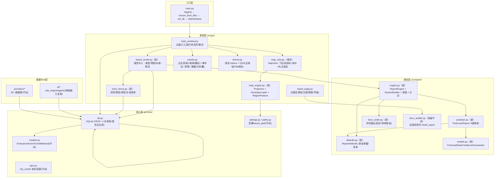
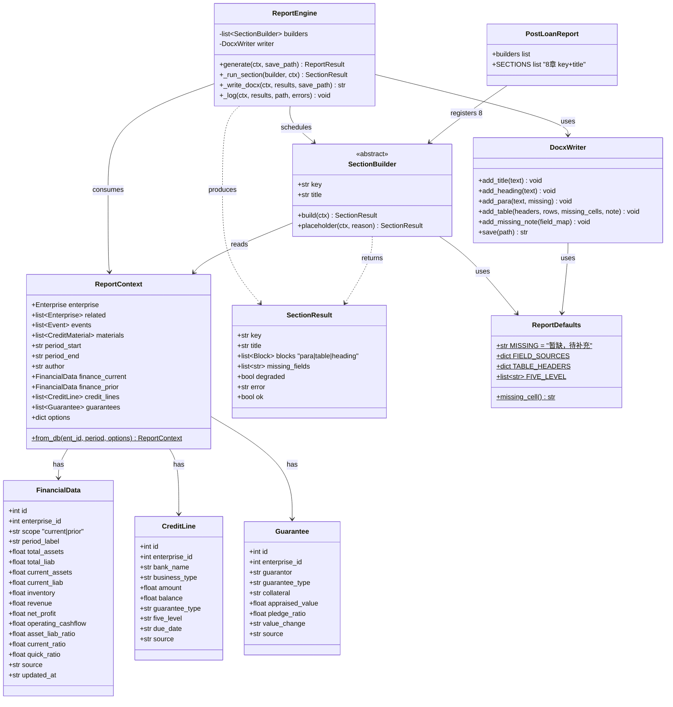
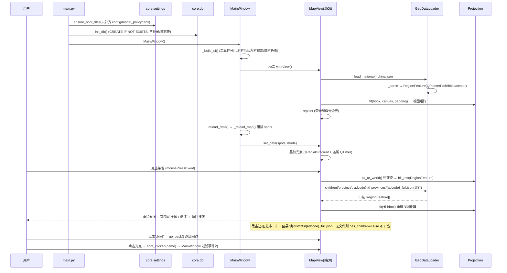
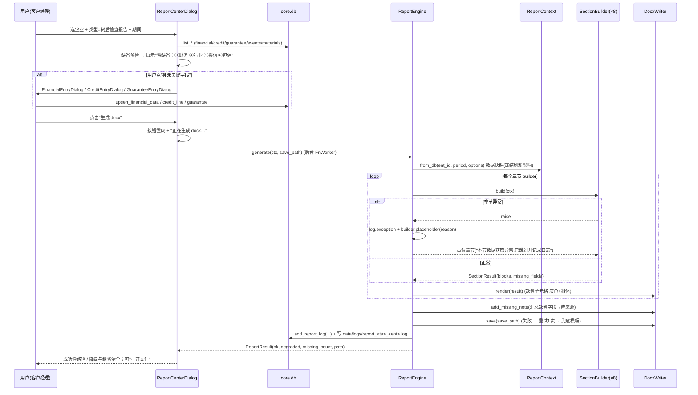
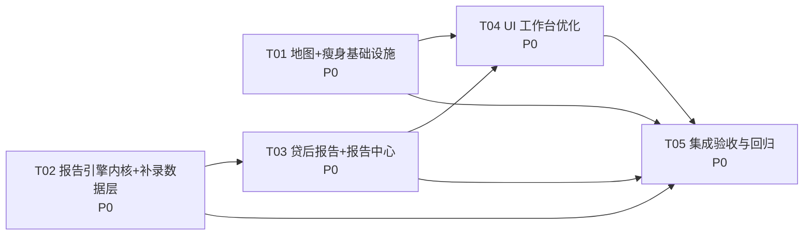

# BankRiskMonitor v2 系统架构设计 + 任务分解

> 文档类型：系统架构设计（SAD）· 版本：v2 升级 · 状态：待评审
> 编制：高见远（架构师） · 上游输入：`docs/PRD-v2.md`（许清楚） · 适用对象：研发/测试/主理人
> 目标读者为可直接施工的工程师：本文档中的类名、文件路径、函数签名、DDL、spec 片段均可直接落码。

---

## 0. 结论速览（TL;DR）

| 诉求 | 架构落点 | 关键决策 |
|---|---|---|
| ① 体积瘦身（254MB→≤80MB） | 移除 QtWebEngine；纯 Qt 自绘地图；spec `onedir` + `excludes` + datas/binaries 过滤 | **onedir + UPX**；浏览器内核 195MB 整体剥离 |
| ② UI 优化 | `main_window.py`（工具栏分组/报告主按钮/右栏 Tab）、`panels.py`（搜索+风险徽标+折叠）、`theme.py`（主按钮/Tab 角标样式） | 不改地图核心能力，仅信息架构重排 |
| ③ 稳定报告引擎 | 新增 `src/report/engine.py`（章节注册表 + 单章 try/except + 重试 + 兜底 + 日志） | **确定性优先**：默认规则引擎，AI 仅增强 |
| ④ 贷后报告 + 缺省 | 新增 `src/report/postloan.py`（8 章映射）+ `defaults.py`（缺省常量/清单）+ 补录数据表 | **零伪造**：缺省字段统一"暂缺，待补充" |

**任务分解结论**：拆为 **5 个任务**（T01~T05），按"地图替换与瘦身基础设施 → 报告引擎内核 → 贷后报告 → UI 整合 → 集成验收"依赖排序。

---

## 1. 实现方案与框架选型

### 1.1 总体思路

在**不改变现有分层与对外契约**的前提下做三块增强 + 一块减重：

1. **减重（G1）**：把"只为渲染一张地图而携带 195MB 浏览器内核"的既有方案，改为 **QPainter 纯 Qt 自绘**。这是瘦身的首要杠杆，且顺带移除 `QtWebChannel/QtQml/QtQuick*` 等一长串连带依赖。
2. **增强报告（G2/G3）**：把现有 `report_page.py → docx_builder.build_report()` 的"一次性拼装"升级为**分层报告引擎**——数据快照层（`ReportContext`）→ 章节构建层（`SectionBuilder`）→ 容错调度层（`ReportEngine`）→ 样式输出层（`DocxWriter`）。旧路径（日报/周报/事件专报）保持 `docx_builder.build_report()` 完全不变，新旧互不影响。
3. **增强易用（G4）**：主工作台信息架构重排，贷后报告入口前置为主按钮，报告中心提供缺省预检与补录。
4. **不改契约**：`core/models.py` 既有 `Enterprise/Event/CreditMaterial` 字段**不增删**（新增独立补录 dataclass）；`core/geo.py`、`core/relevance.py`、`providers/*`、`ai/*` 全部保持不动。

### 1.2 关键技术决策

#### 决策 A：地图"纯 Qt 自绘"的投影与命中算法选型

**投影**：GeoJSON 坐标为 `[lon, lat]`（GCJ-02 火星坐标），且各层级（全国/省/市）的几何是**独立文件、各自坐标系一致但范围不同**。选型结论：

- **采用"每级自适应 + 纬度余弦压缩的等距圆柱（equirectangular）投影"**，而非 Web Mercator。
  - 理由：① ECharts 的 `geo` 也在每级自动 fit 到画布，视觉上"每级铺满"更贴合复刻目标；② 银行内网地图不需要米级测地精度，等距圆柱 + `cos(lat_mid)` 经度压缩即可得到自然的中图轮廓；③ 实现简单、可逆、无外部依赖。
  - 公式（对当前层级 bbox `(min_lon,min_lat,max_lon,max_lat)`、画布 `(W,H)`、留白 `p`）：

```
k    = cos(radians((min_lat+max_lat)/2))        # 经度压缩系数
ww   = (max_lon-min_lon)*k ; wh = (max_lat-min_lat)
s    = min((W-2p)/ww, (H-2p)/wh)                # 均匀缩放
tx   = p + ((W-2p)-ww*s)/2 ; ty = p + ((H-2p)-wh*s)/2
world_to_px(lon,lat) = ( tx + (lon-min_lon)*k*s ,  ty + (max_lat-lat)*s )   # y 轴翻转
px_to_world(x,y)     = ( min_lon + (x-tx)/(k*s) ,  max_lat - (y-ty)/s )
```

  平移/缩放叠加在拟合之上：`px = tx + (lon-min_lon)*k*s*z + dx`；缩放以鼠标锚点为中心，反解 `dx,dy` 保持锚点不动。

- **渲染**：几何**只投影一次**为 `QPainterPath`（世界坐标，单位=投影单位），平移/缩放通过 `QPainter.setTransform()` 施加视图矩阵，**不重建路径**（性能关键：中国 35 个 feature、省级最多 ~21、区县 ~13，路径常驻内存，帧间只改矩阵）。
- **命中检测**：把点击像素经视图矩阵**逆变换回世界坐标**，用 `QPainterPath.contains(QPointF)` 判定；先以 feature 的 bbox 做预筛。选型理由：`path.contains` 是 Qt 原生、与渲染共用同一几何、缩放下自动一致，避免自己实现"点在多边形内"的射线法带来的边界毛刺。
- **辉光/光点**：荧光绿边界用"多遍描边"模拟辉光（宽而半透明的外层 + 细而亮的内层）；光点用 `QRadialGradient` + 同心圆涟漪（`QTimer` 约 25–30fps，`update()` 重绘叠加层）。深色底 `#0D1420`、边界/主色沿用 `theme.PRIMARY=#00FF9C`，与既有大屏主题一致。

#### 决策 B：报告引擎的分层与容错模式

- **分层**：`ReportContext`（生成瞬间的数据快照，冻结后台刷新影响）→ `SectionBuilder`（本章数据→渲染块的纯函数）→ `ReportEngine`（有序注册表 + 调度 + 容错）→ `DocxWriter`（样式输出）。
- **单章容错（硬要求落地）**：`ReportEngine.generate()` 对每个 `builder` 单独 `try/except`；异常时调用 `builder.placeholder(ctx, reason)` 生成**占位章节**（"本节数据获取异常，已跳过并记录日志"），其余章节照常输出；异常落入生成日志。
- **确定性优先**：正文默认走**规则引擎**（`SectionBuilder` 内纯 Python 统计/拼接，不调用网络/AI）；AI 仅在"AI 影响研判"增强位可选调用，超时/失败**自动回退**规则文本。
- **强保证三连**：① docx `save()` 失败自动**重试 1 次**；② 仍失败输出**兜底模板**（标题 + 说明 + 异常清单，保证是合法可打开 docx）；③ 数据全空也产出合法 docx（输出"报告期内无监测事件"等标准文案，而非报错）。
- **生成日志**：每次生成写 `data/logs/report_<ts>_<ent>.log`（JSONLines：时间/期间/章节状态 ok|degraded|missing/缺省字段清单/异常/引擎），并在 `report_log` 表留一条摘要供报告中心查看。

#### 决策 C：打包策略 onedir vs onefile 的取舍与结论

| 维度 | onefile（v1 现状） | **onedir（v2 采用）** |
|---|---|---|
| 冷启动 | 每次解压到临时目录，慢 | **直接映射，启动快（满足 ≤3s）** |
| 体积可控性 | 单文件大 blob，难剔 | **可按目录/data 过滤，剔除 translations/qml/resources** |
| 分发形态 | 单 exe，最简 | 一个文件夹（可再打 7z 自解压） |
| UPX | 可用 | 可用（对 Qt DLL 压缩） |
| WebEngine 依赖 | 强耦合 | 剥离后无 |

**结论：采用 `onedir + upx=True`**。孤立的 `dist/BankRiskMonitor/BankRiskMonitor.exe`（bootloader）极小，验收口径为**整个 `dist/BankRiskMonitor/` 目录总占用 ≤80MB**（与 PRD"onedir 或单文件，总占用 ≤80MB"一致）。

### 1.3 瘦身预算估算（验证可达 ≤80MB）

| 项 | v1 | v2 处置 | 预估 v2 |
|---|---|---|---|
| Qt6WebEngineCore.dll | 195MB | 移除（改纯 Qt） | 0 |
| PySide6/resources/（devtools pak 等） | 102MB | 移除（WebEngine 专属） | 0 |
| PySide6/translations/ | 60MB | 仅保留 `qtbase_zh_CN.qm` | <0.3MB |
| PySide6/qml + Quick3D + Graphs/Charts/DataViz | ~40MB | excludes | 0 |
| Qt6Pdf / Qt6Designer / Qt6ShaderTools / Qt6Multimedia(av*) | ~30MB | excludes | 0 |
| opengl32sw.dll | 20MB | 尝试移除（见风险 R2） | 0~20MB |
| QtCore/QtGui/QtWidgets/QtNetwork/QtSvg + plugins | — | 保留 | ~35~50MB |
| Python 运行时 + 三方库（docx/openpyxl/lxml/bs4/requests/yaml/pypdf/feedparser） | — | 保留 | ~15~25MB |
| **合计（onedir 目录）** | 254MB(exe) | — | **约 60~80MB** |

---

## 2. 架构分层图、模块职责与文件清单

### 2.1 分层架构图



### 2.2 模块职责（新增/改动/删除，逐条）

#### 新增文件

| 相对路径 | 一句话职责 |
|---|---|
| `src/gui/map_engine.py` | `Projection`（经纬度↔画布坐标拟合/平移/缩放/逆变换）、`GeoDataLoader`（按层级/adcode 加载并缓存 GeoJSON→`RegionFeature`）、`RegionFeature`（名称/adcode/level/rings/bbox/center + `contains(lon,lat)`）。纯几何，无 QWidget，可单测。 |
| `src/gui/report_center.py` | 报告中心 `ReportCenterDialog`：报告类型（含"贷后检查报告"）、期间、监测对象、**缺省预检**提示、补录/上传入口、逐章预览与"生成 docx"，全程加载态/结果反馈。 |
| `src/gui/entry_forms.py` | 手动补录表单：`FinancialEntryDialog`（财务指标）／`CreditEntryDialog`（授信情况）／`GuaranteeEntryDialog`（担保情况），写入补录表。 |
| `src/report/engine.py` | `ReportEngine`（章节注册表、单章 try/except、重试、兜底模板、日志落盘、`report_log` 入库）、`SectionBuilder`（抽象）、`SectionResult`、`ReportContext`（数据快照）。 |
| `src/report/postloan.py` | `PostLoanReport`：注册 8 个 `SectionBuilder` 子类（按银行 8 章顺序），内置 3 张骨架表（资金流向/财务指标对比/担保情况）与"缺省数据说明"小节。 |
| `src/report/docx_writer.py` | `DocxWriter`：样式输出层，复用 `docx_builder` 的字体/字号/行距约定，扩展"缺省单元格灰色+斜体"渲染。 |
| `src/report/defaults.py` | `ReportDefaults`：缺省文案常量（`MISSING="暂缺，待补充"`）、缺省字段→应来源清单、表头定义、五级分类建议词表。 |
| `src/report/models.py` | 补录数据模型：`FinancialData` / `CreditLine` / `Guarantee` dataclass 与字段目录（供表单与映射共用）。 |
| `tools/verify_package.py` | 瘦身验证脚本：遍历 `dist/BankRiskMonitor/` 断言总大小 ≤80MB、断言无 WebEngine/被排除产物，输出体积明细。 |
| `docs/ARCH-v2.md` / `docs/class-diagram.mermaid` / `docs/sequence-diagram.mermaid` | 本设计与两张图（架构交付物）。 |

#### 改动文件

| 相对路径 | 改动要点 |
|---|---|
| `src/gui/map_view.py` | **重写**为纯 Qt `MapView`（QWidget）：下钻状态机（全国→省→市→区县）、面包屑/返回、命中检测、光点涟漪渲染、平移缩放；保留 `spot_clicked = Signal(str)` 与 `set_data(spots, mode=None)` 对外签名（兼容既有测试），移除全部 `QtWebEngine*`/`QtWebChannel` 导入。 |
| `src/gui/main_window.py` | 工具栏分三组（监控/分析/报告）+ 分隔符；"生成报告"提级为主按钮（右对齐 `QToolButton[primary=true]`）；右栏 `QSplitter(V)` 改为 `QTabWidget`（事件流/预警 角标）；底栏摘要接折叠；`_gen_report()` 打开 `ReportCenterDialog`；地图光点联动保持不变。 |
| `src/gui/panels.py` | `EnterpriseListPanel` 增搜索框 + 风险徽标（高/中/低/无）+ 状态点 + 过滤（全部/高危/中危）+ 空态；`AISummaryPanel` 增折叠头；`AlertPanel` 提供"高危+中危计数"供 Tab 角标。 |
| `src/gui/theme.py` | QSS 增补：`QToolButton[primary="true"]` 三态、Tab 角标徽标样式、`QLabel[badge="high|medium|low|none"]` 颜色类、地图覆盖控件（面包屑/返回/图例）样式；沿用既有 tokens。 |
| `src/gui/report_page.py` | 保留日报/周报/事件专报逻辑；工作台入口改为经 `ReportCenterDialog` 进入（或在其内作为"轻量快报"页签），不改其 `build_report` 调用。 |
| `src/core/db.py` | 新增表与 CRUD：`financial_data` / `credit_line` / `guarantee` / `report_log`（DDL 见 §3.4）；`init_db()` 幂等 `CREATE TABLE IF NOT EXISTS`，升级对老库零破坏。 |
| `src/core/models.py` | **仅新增**独立 dataclass（`FinancialData/CreditLine/Guarantee` 可置于 `src/report/models.py`，避免动契约文件；若放此处也仅为新增不修改）。既有 dataclass 字段不动。 |
| `BankRiskMonitor.spec` | 改 `onedir`（`COLLECT`）、`excludes` 清单、datas/binaries 过滤（剔 translations/qml/resources/opengl32sw）。 |
| `build_exe.bat` | 文案与产物路径改为 `dist\BankRiskMonitor\`；追加瘦身校验调用 `python tools\verify_package.py`。 |
| `tests/test_map_geo.py` | 保留既有 `core.geo` 用例；新增地图引擎用例（Projection 往返、GeoDataLoader 解析、RegionFeature.contains）。 |
| `tests/test_gui_social.py` / `tests/test_gui_settings.py` | 移除"QtWebEngine 先于 QApplication 导入""QTWEBENGINE_CHROMIUM_FLAGS""atexit 强制退程"等已失效的 Chromium 兼容代码；MapView 冒烟改为纯 Qt 断言。 |
| `tests/test_report_engine.py`（新）/`tests/test_postloan_report.py`（新）/`tests/test_map_engine.py`（可并入 test_map_geo.py） | 报告容错/边界/零伪造/8章齐全/3表存在/缺省说明；地图投影与命中。 |

#### 删除文件（资产）

| 相对路径 | 原因 |
|---|---|
| `src/assets/echarts.min.js` | 不再需要 JS 地图库（1.0MB） |
| `src/assets/map.html` | WebEngine 页面废弃 |
| `src/assets/map_fallback.html` | WebEngine 降级页废弃 |
| （打包时）`dist/BankRiskMonitor/**/Qt6WebEngineCore.dll`、`resources/`、`qml/`、`translations/*`（保留 zh_CN）、`opengl32sw.dll` | 由 spec 过滤剔除 |

> **保留**：`china.json`、`geo/provinces/*.json`（31）、`geo/districts/*.json`（36）、`geo/city_centers.json` 全部保留（纯 Qt 地图继续使用 `city_centers.json` 做光点坐标回退与 `core.geo` 契约）。

---

## 3. 数据结构与接口（类图）

### 3.1 地图子系统（classDiagram 片段）

```mermaid
classDiagram
    class RegionFeature {
        +str name
        +int adcode
        +str level  "province|city|district"
        +QPainterPath path  "世界坐标(QPointF)"
        +tuple bbox  "(min_lon,min_lat,max_lon,max_lat)"
        +tuple center  "(lon,lat)"
        +bool contains(x, y) bool  "世界坐标(投影单位)"
        +list~QPointF~ ring_points_hint
    }

    class GeoDataLoader {
        -dict _cache
        +load_national() list~RegionFeature~  "china.json"
        +load_province(adcode) list~RegionFeature~  "geo/provinces/{adcode}_full.json"
        +load_district(adcode) list~RegionFeature~  "geo/districts/{adcode}_full.json"
        +children(level, adcode) list~RegionFeature~
        +has_children(adcode) bool  "区县文件是否存在"
        +_parse(feature) RegionFeature
    }

    class Projection {
        +tuple bbox
        +float k
        +float s0
        +float tx0
        +float ty0
        +float zoom
        +float dx
        +float dy
        +QSize canvas
        +fit(bbox, size, padding) void
        +world_to_px(lon, lat) QPointF
        +px_to_world(x, y) tuple
        +view_transform() QTransform
        +zoom_at(px, factor) void
        +pan(dx, dy) void
        +reset() void
        +hit_test(features, px) RegionFeature
    }

    class MapItem {
        +RegionFeature feature
        +bool hovered
        +bool flash
        +draw(painter, palette) void
    }

    class MapScene {
        +list~MapItem~ items
        +list~Spot~ spots
        +str level
        +int adcode
        +str mode  "severity|category"
        +Projection proj
        +set_features(features) void
        +set_spots(spots, mode) void
        +draw(painter, rect) void
        +on_click(px) object  "命中区域或光点"
    }

    class MapView {
        +Signal spot_clicked(str)
        +Signal region_clicked(object)
        +Signal level_changed(str)
        +MapScene scene
        +GeoDataLoader loader
        +_loaded bool
        +_pending object
        +set_data(spots, mode) void
        +drill(feature) void
        +go_back() void
        +reset() void
        +paintEvent(e) void
        +mousePressEvent(e) void
        +mouseMoveEvent(e) void
        +wheelEvent(e) void
    }

    MapView --> MapScene : owns
    MapView --> GeoDataLoader : uses
    MapScene --> Projection : uses
    MapScene --> MapItem : contains
    MapItem --> RegionFeature : wraps
    GeoDataLoader --> RegionFeature : creates
    Projection ..> RegionFeature : hit_test
```

**对外契约（必须保持）**：
- `MapView.spot_clicked: Signal(str)` —— 点击光点回传企业名（`main_window._on_spot_clicked` 消费）。
- `MapView.set_data(spots: list, mode: str | None = None) -> None` —— `spots` 元素结构沿用 v1：`{name, province, city, lng, lat, event_count, severity, categories, events[]}`（`main_window._reload_map` 组装，无需改）。
- `MapView._loaded: bool` 与 `MapView._pending` —— 为兼容 `tests/test_gui_social.py` 冒烟断言保留；新版在 `__init__` 即置 `_loaded=True`、`_pending=None`。

### 3.2 报告子系统（classDiagram 片段）



### 3.3 贷后报告 8 章 → SectionBuilder 映射（key 命名冻结）

| 章序 | key（冻结） | 章节名 | 数据来源 | 缺省策略 |
|---|---|---|---|---|
| ① | `basic_info` | 客户基本情况 | `Enterprise`(name/credit_code/province/city) + `biz_change` 事件 | 信用代码等缺失→"暂缺，待补充" |
| ② | `management` | 客户经营管理情况 | `biz_change`+`news` 事件汇总 | 无→"报告期内未采集到经营异常信息" |
| ③ | `finance` | 客户财务状况 | `FinancialData`(current/prior) | **全字段缺省**：出"财务指标对比表"骨架（本期/上年同期/比较列） |
| ④ | `industry` | 客户所在行业情况 | 可选从 news/biz 推断（参考） | 缺省；"暂缺，待补充" |
| ⑤ | `credit` | 客户在我行及他行授信情况 | `credit_note` + `CreditLine` + 材料文本 | 无→整表骨架（授信银行/笔数/余额/品种/担保方式/五级分类/到期日） |
| ⑥ | `guarantee` | 客户担保情况 | `Guarantee` + 材料文本 | 无→骨架（保证人/抵质押物/评估价值/抵质押率/价值变动） |
| ⑦ | `risk_analysis` | 客户授信风险分析 | `Event(severity/ai_verdict/relevance)` + 穿透 | 无事件→"未发现显著风险信号" |
| ⑧ | `mgmt_conclusion` | 贷后管理执行情况与结论 | 规则生成：事件统计 + 建议五级分类 + 下一步措施 | 始终生成 |
| 附 | `missing_note` | 缺省数据说明 | 汇总所有 `missing_fields` | 逐条列出缺省字段及应来源 |

**3 张骨架表（必出）**：`资金流向跟踪表`（资金用途/交易对手/金额/时间，全缺省时仅表头）、`财务指标对比表`（指标 | 上年同期 | 本期 | 比较）、`担保情况表`。表头定义集中在 `ReportDefaults.TABLE_HEADERS`。

### 3.4 补录与日志：SQLite DDL（新增表）

```sql
-- 财务数据（本期 / 上年同期两行，NULL 表示缺省，零伪造）
CREATE TABLE IF NOT EXISTS financial_data (
    id INTEGER PRIMARY KEY AUTOINCREMENT,
    enterprise_id INTEGER NOT NULL,
    scope TEXT NOT NULL DEFAULT 'current',     -- current=本期 / prior=上年同期
    period_label TEXT DEFAULT '',
    total_assets REAL, total_liab REAL,
    current_assets REAL, current_liab REAL, inventory REAL,
    revenue REAL, net_profit REAL, operating_cashflow REAL,
    asset_liab_ratio REAL, current_ratio REAL, quick_ratio REAL,
    source TEXT DEFAULT '',
    updated_at TEXT DEFAULT (datetime('now','localtime')),
    UNIQUE(enterprise_id, scope)
);

-- 授信情况（一家多笔）
CREATE TABLE IF NOT EXISTS credit_line (
    id INTEGER PRIMARY KEY AUTOINCREMENT,
    enterprise_id INTEGER NOT NULL,
    bank_name TEXT DEFAULT '', business_type TEXT DEFAULT '',
    amount REAL, balance REAL,
    guarantee_type TEXT DEFAULT '', five_level TEXT DEFAULT '', due_date TEXT DEFAULT '',
    source TEXT DEFAULT '',
    updated_at TEXT DEFAULT (datetime('now','localtime'))
);

-- 担保情况
CREATE TABLE IF NOT EXISTS guarantee (
    id INTEGER PRIMARY KEY AUTOINCREMENT,
    enterprise_id INTEGER NOT NULL,
    guarantor TEXT DEFAULT '', guarantee_type TEXT DEFAULT '',
    collateral TEXT DEFAULT '', appraised_value REAL, pledge_ratio REAL,
    value_change TEXT DEFAULT '', source TEXT DEFAULT '',
    updated_at TEXT DEFAULT (datetime('now','localtime'))
);

-- 报告生成日志（报告中心可查看）
CREATE TABLE IF NOT EXISTS report_log (
    id INTEGER PRIMARY KEY AUTOINCREMENT,
    kind TEXT NOT NULL,                 -- postloan / daily / weekly / special
    enterprise_id INTEGER,
    period_start TEXT, period_end TEXT,
    save_path TEXT DEFAULT '',
    sections_ok INTEGER DEFAULT 0,
    sections_degraded INTEGER DEFAULT 0,
    missing_count INTEGER DEFAULT 0,
    errors TEXT DEFAULT '',             -- JSON: [[section,msg],...]
    engine TEXT DEFAULT 'rule',
    created_at TEXT DEFAULT (datetime('now','localtime'))
);
```

**db.py 新增 CRUD（契约）**：
```
upsert_financial_data(ent_id, scope, **fields) -> int
get_financial_data(ent_id, scope) -> Optional[FinancialData]
upsert_credit_line(ent_id, fields: dict) -> int        # 或 insert + list
list_credit_lines(ent_id) -> List[CreditLine]
add_guarantee(ent_id, fields: dict) -> int
list_guarantees(ent_id) -> List[Guarantee]
add_report_log(kind, ent_id, ps, pe, save_path, ok, degraded, missing, errors, engine) -> int
list_report_logs(limit=50) -> list
```

---

## 4. 程序调用流程（时序图）

### 4.1 启动 → 加载地图 → 下钻交互



### 4.2 选企业 → 生成贷后报告 →（补录）→ 生成 → 落盘 → 打开



---

## 5. 任务列表（有序、含依赖与产出）

> **任务数硬约束：共 5 个（≤5）**。每个任务 ≥3 个相关文件；按功能模块分组，不按单文件拆分。
> **关于"首任务=项目基础设施"**：本项目为**既有系统升级**，v2 的"基础设施"即"打包/依赖/资源治理 + 首块能力改造"。T01 已把构建声明（spec/build.bat/资源删除/依赖）与地图能力改造合并为一个"地基任务"，满足该规则的精神（详见 §5 说明）。

### T01 — 地图纯 Qt 自绘替换 + 移除 QtWebEngine + 打包瘦身基础设施 ｜ P0
- **产出文件**：
  - 新增 `src/gui/map_engine.py`、`src/gui/map_view.py`（重写）、`tools/verify_package.py`
  - 修改 `BankRiskMonitor.spec`（onedir + excludes + datas/binaries 过滤）、`build_exe.bat`
  - 删除 `src/assets/echarts.min.js`、`src/assets/map.html`、`src/assets/map_fallback.html`
  - 修改 `tests/test_map_geo.py`（+引擎用例）、`tests/test_gui_social.py`、`tests/test_gui_settings.py`
- **依赖**：无
- **验收点**：
  1. 全应用无 `QtWebEngine*`/`QtWebChannel` 导入（`grep -rn "WebEngine" src` 为空）；
  2. 地图四级下钻、面包屑/返回、光点落点与点击详情、平移缩放与 v1 一致（人工 + 现有 géo 用例）；
  3. `MapView.set_data/spot_clicked` 契约不变，`test_gui_social` 冒烟通过；
  4. `python tools\verify_package.py` 输出总占用 **≤80MB** 且无被排除产物；
  5. `build_exe.bat` 产 `dist\BankRiskMonitor\`，冷启动 ≤3s。

### T02 — 报告引擎内核 + 补录数据层 ｜ P0
- **产出文件**：
  - 新增 `src/report/engine.py`、`src/report/defaults.py`、`src/report/docx_writer.py`、`src/report/models.py`、`tests/test_report_engine.py`
  - 修改 `src/core/db.py`（4 张新表 + CRUD）
- **依赖**：无（可与 T01 并行）
- **验收点**：
  1. `ReportEngine` 支持章节注册表 + 单章 try/except 容错 + 占位渲染 + 重试1次 + 兜底模板；
  2. 边界三连测（AI 掉线/无事件/数据为空）**100% 生成可打开 docx**；脚本连续 **50 次 0 失败**；
  3. 单章人为抛异常，报告仍完整、日志含异常章节名；
  4. 每次生成落一条 `report_log` + 一份 `data/logs/*.log`；
  5. `FinancialData/CreditLine/Guarantee` 可 CRUD 往返（NULL=缺省）。

### T03 — 贷后检查报告（8 章 + 3 表 + 缺省）+ 报告中心 + 补录 UI ｜ P0
- **产出文件**：
  - 新增 `src/report/postloan.py`、`src/gui/report_center.py`、`src/gui/entry_forms.py`、`tests/test_postloan_report.py`
  - 修改 `src/gui/report_page.py`（入口经报告中心）
- **依赖**：T02
- **验收点**：
  1. "贷后检查报告"docx 含**全部 8 章**（无数据章节以骨架 +"暂缺，待补充"呈现），齐全率 100%；
  2. 3 张配套表存在且表头正确；末尾含"缺省数据说明"小节，清单与实际缺省一致；
  3. 全文字段扫描**无伪造数值**（抽查 100% 通过）；
  4. 报告期间/编制人/标题/字体（黑体小二/宋体小四/1.5 倍行距）符合既有规范；
  5. 补录后对应字段显示实值；核心动线"选企业→生成贷后报告"点击 ≤3。

### T04 — 主工作台 UI 优化与整合 ｜ P0
- **产出文件**：修改 `src/gui/main_window.py`、`src/gui/panels.py`、`src/gui/theme.py`
- **依赖**：T01、T03
- **验收点**：
  1. 工具栏分监控/分析/报告三组（有分隔符），"生成报告"为高亮主按钮且首屏可见；
  2. 左栏搜索即时过滤、风险徽标与最高严重度一致、空态文案；状态点；
  3. 右栏事件流/预警改 Tab，预警 Tab 角标=高危+中危计数，切换保留筛选；
  4. 底栏摘要可折叠/展开即时生效；
  5. 空态/加载态/生成中/刷新中均有可见反馈，无功能回归。

### T05 — 集成验收与回归 ｜ P0
- **产出文件**：
  - 新增 `tests/test_report_engine.py`（如 T02 未覆盖的集成项）、`tools/verify_package.py`（若 T01 未含）、`tools/verify_report.py`（50 次生成 + 字段零伪造扫描）
  - 修改 `docs/ARCH-v2.md`（回填最终验证结论）及必要的测试修正
- **依赖**：T01、T02、T03、T04
- **验收点**：
  1. `pytest tests\ -x -q` 全绿（含新增用例，旧用例不回归）；
  2. 瘦身/启动/报告/UI 四组验收脚本全部通过并落盘报告；
  3. 断网冷启动全功能可用（离线优先不回归）。

**任务依赖图**



> **推进建议**：T01 与 T02 **无相互依赖，可并行开工**（T01 由一位工程师、T02 由另一位）；T03 紧随 T02；T04 需 T01+T03 就绪；T05 收口。

---

## 6. 依赖包列表

### 6.1 结论

**不引入任何新的第三方运行时依赖。** 纯 Qt 地图只用 PySide6 既有模块（`QtCore/QtGui/QtWidgets`）；报告沿用 `python-docx`；补录沿用 `sqlite3`（标准库）。这符合"不应引入新的重型依赖"的约束，也服务于瘦身目标。

### 6.2 变化清单

| 包 | 变化 | 说明 |
|---|---|---|
| `PySide6` | 保留（**移除子模块**） | 代码层面不再 import `PySide6.QtWebEngineCore/QtWebEngineWidgets/QtWebChannel`；打包层面 `excludes` 剔除全部未用子模块。版本仍 `>=6.6`（实测 6.11.2）。 |
| `python-docx` | 保留 | 报告输出。 |
| `openpyxl` | 保留 | 报告/名单导入导出（现有）。 |
| `requests/beautifulsoup4/lxml/feedparser/PyYAML/pypdf` | 保留 | providers/材料解析（现有）。 |
| ~~新增~~ | **无** | 不新增。 |

### 6.3 打包器实际依赖（build-time only）

`PyInstaller>=6.6`（实测 6.21.0）；仅构建期使用，不进入产物运行时依赖。

### 6.4 requirements.txt 无需改动

现有 `requirements.txt` 不含任何 WebEngine 专属项（WebEngine 属 PySide6 自带子模块），故**文本不变**；"移除了什么"体现在 spec 的 `excludes`，不体现在 pip 依赖。

---

## 7. 共享知识（跨文件约定）

### 7.1 缺省值常量与文案（零伪造根基）
- **唯一缺省文案**：`ReportDefaults.MISSING = "暂缺，待补充"`。**任何**缺省单元格/字段一律用它，禁止空串、禁止 `-`、禁止数字占位。
- **正常"无数据"文案**（与"缺省"区分）：
  - 无事件：`"报告期内无监测事件。"` / 经营异常：`"报告期内未采集到经营异常信息"`
  - 无风险信号：`"未发现显著风险信号"`
- **缺省字段→应来源** 集中登记于 `ReportDefaults.FIELD_SOURCES`，用于报告末尾"缺省数据说明"逐条列出。
- **样式约定**：缺省内容一律**灰色 + 斜体**（`DocxWriter` 内 `_style_run(color=GREY, italic=True)`），与真实数据可肉眼区分；灰色常量 `DOCX_MISSING_GREY = "808080"`。

### 7.2 颜色 / 字体常量（沿用，不新造）
- 主题 tokens：直接复用 `src/gui/theme.py`（`PRIMARY=#00FF9C`、`TEXT_MAIN`、`TEXT_SECOND`、`SPACE=8`、`SEVERITY_RED/ORANGE/YELLOW/BLUE/GREEN`、`CATEGORY_COLORS`）。
- 地图配色沿用 v1 `map.html` 语义（与 `theme` 对齐）：`SEV_COLORS={high:#FF4D4D, medium:#FFA033, low:#FFD84D, none:#00FF9C}`；`CAT_COLORS={enforcement:#FF4D4D, lawsuit:#FFD84D, biz_change:#FFA033, news:#4DA3FF, social:#C77DFF}`；`CAT_ORDER=["enforcement","lawsuit","biz_change","news","social"]`；地图底色 `#0D1420`。
- docx 字体/字号：复用 `docx_builder` 的 `_FONT_HEI=黑体 / _FONT_SONG=宋体 / _SIZE_TITLE=18 / _SIZE_HEAD=14 / _SIZE_BODY=12 / _SIZE_TABLE=10.5`，行距 1.5。`DocxWriter` 不重定义，`import` 复用。

### 7.3 投影/几何函数签名（冻结）
```
Projection.fit(bbox: tuple, size: QSize, padding: int) -> None
Projection.world_to_px(lon: float, lat: float) -> QPointF
Projection.px_to_world(x: float, y: float) -> tuple[float, float]
Projection.view_transform() -> QTransform          # 供 painter.setTransform
Projection.zoom_at(px: QPointF, factor: float) -> None
Projection.pan(dx: float, dy: float) -> None
Projection.reset() -> None
Projection.hit_test(features: list[RegionFeature], px: QPointF) -> RegionFeature | None
RegionFeature.contains(world_pt: QPointF) -> bool   # QPainterPath.contains
GeoDataLoader.load_national() -> list[RegionFeature]
GeoDataLoader.load_province(adcode: int) -> list[RegionFeature]
GeoDataLoader.load_district(adcode: int) -> list[RegionFeature]
GeoDataLoader.children(level: str, adcode: int) -> list[RegionFeature]
GeoDataLoader.has_children(adcode: int) -> bool
```
- **世界坐标系定义**：`world = (lon * k, -lat)`（k 为当前级纬度余弦系数）；`QPainterPath` 建在世界坐标，视图矩阵由 `view_transform()` 提供。`px_to_world` 返回的是**世界坐标**，`contains` 也吃世界坐标——**两者坐标系必须一致**（这是命中正确性的关键约定）。

### 7.4 报告章节 key 命名
- **贷后报告（冻结）**：`basic_info / management / finance / industry / credit / guarantee / risk_analysis / mgmt_conclusion / missing_note`（顺序即 8 章顺序，`missing_note` 为附录）。
- **旧报告（冻结，勿动）**：`overview / events / ai / penetration / alerts / advice`（见 `docx_builder.CHAPTER_DEFS`、`dialogs.CHAPTERS`）。
- 新增报告类型 String（`ReportDialog`/`report_log.kind`）：`postloan`（贷后检查报告）、`daily`、`weekly`、`special`。

### 7.5 路径解析约定
- 资源统一走 `core.paths.asset_path(name)`：冻结后基址 `sys._MEIPASS/src/assets`，开发态 `k项目根/src/assets`。地图文件调用示例：`asset_path("china.json")`、`asset_path(os.path.join("geo","provinces","330000_full.json"))`、`asset_path(os.path.join("geo","city_centers.json"))`。
- 数据/日志目录：`core.paths.app_root()/data`（便携）；报告日志 `data/logs/`；报告默认输出 `core.paths.reports_dir()`。
- 打包 `datas=[('src/assets','src/assets')]` **保持不变**（删除 3 个废弃资产即可）。

### 7.6 异常与日志约定
- 报告引擎 logger 名：`src.report.engine`；单章异常 `log.exception(...)` + 占位渲染；docx 写失败 `log.warning` + 重试；二次失败 `log.error` + 兜底模板。
- 生成日志文件：`data/logs/report_<YYYYmmdd_HHMMSS>_<ent>.log`，JSONLines：`{"ts","section","status","missing","error"}`。
- 地图加载缺文件：**不抛异常**——`GeoDataLoader` 返回空列表，`MapView` 在画布居中显示"该区域无下级边界数据"（沿用 v1 的"无市级数据"降级文案语义）。
- provider/AI 异常：沿用现状（`run_with_fallback`、`AIUnavailableError` 降级），报告引擎对 AI 增强位额外兜底。

### 7.7 测试兼容约定
- **不得删除** 现有 `tests/` 用例；`test_map_geo.py` 既有 `core.geo` 断言（`norm_city/city_center`）**原样保留**（这些测的是 `core/geo.py`，本次不动）。
- `test_map_geo.py` 更新策略：**追加**地图引擎用例，不改既有函数名与断言；新增用例建议：
  - `Projection` 往返：`px_to_world(world_to_px(lon,lat)) ≈ (lon,lat)`（容差 1e-6）；
  - `GeoDataLoader.load_national()` 返回 35 个 feature、`load_province(330000)` 返回杭州市等；
  - `RegionFeature.contains` 对省会中心点返回 True、对境外点返回 False。
- `test_gui_social.py`/`test_gui_settings.py` 更新策略：删除已失效的 Chromium 兼容代码（`QTWEBENGINE_CHROMIUM_FLAGS` 环境变量、atexit 强制退程、"WebEngine 先于 QApplication 导入"注释），MapView 冒烟改为纯 Qt：构造 `MapView()` → `set_data(spots,"category")` → `QApplication.processEvents()` → 断言无异常且 `mv._pending is None`（新版 `_loaded=True` 即时命中）。
- docx 契约：旧的 `docx_builder.build_report(title, period_start, period_end, author, sections, event_rows, save_path) -> str` **签名与行为不变**，`report_page.py` 继续调用它，保证日报/周报/事件专报零回归。

---

## 8. 待明确事项（技术层风险与疑问，≤5）

| # | 事项 | 风险 | 缓解建议 |
|---|---|---|---|
| R1 | **交付形态**：onedir 是文件夹而非单 exe | 若客户/交付方坚持"单个 exe"，onedir 不直接满足 | 论证 onedir 启动与体积优势；如需单文件，用 **7z 自解压（SFX）** 包成单 exe（解压后运行，不牺牲体积），或保留 onefile 但接受冷启动变慢。请主理人向用户确认交付形态。 |
| R2 | **`opengl32sw.dll`(20MB) 可否剔除** | 无独显/虚拟机的老机器可能依赖软件 OpenGL，剔除或致白屏/渲染异常 | 先在验证机剔除测试并跑地图四级下钻；若异常立即保留该 DLL（+20MB，仍在 ≤80MB 预算内）。建议保守：**默认移除 + 冒烟回滚开关**。 |
| R3 | **地图交互保真度**：ECharts `roam` 的惯性/缩放手感 vs 自绘 | 手感差异可能被判定"地图能力回归" | 定义**最小交互清单**（下钻、返回、点击光点、滚轮缩放、拖拽平移、悬停高亮）作为验收基线；惯性动画不在基线内。请确认是否接受非像素级/非手感级复刻。 |
| R4 | **财务/授信补录口径**：本期 vs 上年同期两列是否够用、是否需导入既有 Excel 财报 | 银行财报常为多期、多科目，固定列可能不足 | v2 先落"本期 + 上年同期"两 scope（满足"同比列"硬要求）；多期/科目扩展与 Excel 导入列为 **P1-2/P1-3**。请确认最小字段集。 |
| R5 | **光点精度**：`city_centers.json` 为**城市中心**而非企业注册地精确坐标 | 同一城市企业光点重叠（v1 已用同城散列缓解），非真实地址 | 沿用"城市中心 + 同城确定性散列"；如需到区级，需新增区县中心表（可作为 P2）。请确认精度要求。 |

---

## 附录 A：瘦身达标的证明方法（硬要求）

### A.1 spec `excludes` 清单（`BankRiskMonitor.spec`）

```python
excludes = [
    # —— WebEngine（核心 195MB，纯自绘后彻底剥离）——
    'PySide6.QtWebEngineCore', 'PySide6.QtWebEngineWidgets', 'PySide6.QtWebEngineQuick',
    'PySide6.QtWebChannel', 'PySide6.QtWebSockets', 'PySide6.QtWebView',
    # —— QML/Quick/3D ——
    'PySide6.QtQml', 'PySide6.QtQuick', 'PySide6.QtQuickWidgets', 'PySide6.QtQuickControls2',
    'PySide6.QtQuick3D', 'PySide6.Qt3DCore', 'PySide6.Qt3DRender', 'PySide6.Qt3DInput',
    'PySide6.Qt3DLogic', 'PySide6.Qt3DAnimation', 'PySide6.Qt3DExtras',
    # —— 多媒体（含 avcodec/avformat 16MB）——
    'PySide6.QtMultimedia', 'PySide6.QtMultimediaWidgets', 'PySide6.QtSpatialAudio',
    # —— 图表/可视化 ——
    'PySide6.QtCharts', 'PySide6.QtDataVisualization', 'PySide6.QtGraphs', 'PySide6.QtPdf',
    'PySide6.QtPdfWidgets', 'PySide6.QtDesigner', 'PySide6.QtUiTools',
    'PySide6.QtShaderTools', 'PySide6.QtOpenGL', 'PySide6.QtOpenGLWidgets',
    # —— 其余未用子模块 ——
    'PySide6.QtSql', 'PySide6.QtTest', 'PySide6.QtHelp', 'PySide6.QtLocation',
    'PySide6.QtPositioning', 'PySide6.QtBluetooth', 'PySide6.QtNfc', 'PySide6.QtSensors',
    'PySide6.QtSerialPort', 'PySide6.QtRemoteObjects', 'PySide6.QtScxml',
    'PySide6.QtStateMachine', 'PySide6.QtNetworkAuth', 'PySide6.QtTextToSpeech',
    # —— 标准库/其它 ——
    'tkinter', 'unittest', 'pydoc', 'doctest',
]
```

> **网络可用**：保留 `PySide6.QtNetwork`（`requests` 底层不依赖它，但 Qt 可能内部引用，保留更稳）。

### A.2 datas/binaries 过滤（spec 内 `Analysis` 之后追加）

```python
# 过滤掉体积大头：translations(仅留 zh_CN) / resources / qml / opengl32sw.dll
def _keep(entry):
    norm = entry[0].replace('\\', '/').lower()
    if '/pyside6/translations/' in norm:
        return 'zh_cn' in norm
    if '/pyside6/resources/' in norm:      # WebEngine 专属资源
        return False
    if '/pyside6/qml/' in norm:
        return False
    if norm.endswith('opengl32sw.dll'):    # 见风险 R2，默认剔除，异常则放开
        return False
    return True

a.datas = [d for d in a.datas if _keep(d)]
a.binaries = [b for b in a.binaries if _keep(b)]
```

### A.3 需删除的 assets

`src/assets/echarts.min.js`、`src/assets/map.html`、`src/assets/map_fallback.html`（其余 geo 资源全部保留）。

### A.4 验证命令 / 断言（`tools/verify_package.py`）

```
# 断言 1：总占用 ≤80MB
python -c "import os;t=sum(os.path.getsize(os.path.join(r,f)) for r,_,fs in os.walk('dist/BankRiskMonitor') for f in fs);print(round(t/1048576,1),'MB');assert t<=80*1048576"

# 断言 2：无 WebEngine / 被排除产物（Windows）
dir /s /b dist\BankRiskMonitor | findstr /i "Qt6WebEngineCore.dll QtWebEngineProcess.exe resources.pak icudtl.dat Qt6Pdf.dll Qt6Designer.dll Qt6Multimedia.dll Qt6Charts.dll opengl32sw.dll"
# 期望：无输出（exit 非零即通过“未命中”）

# 断言 3：translations 仅 zh_CN、无 qml 目录
dir /s /b dist\BankRiskMonitor\PySide6\translations\*.* | findstr /v /i "zh_CN"
dir /s /b dist\BankRiskMonitor\PySide6\qml 2>nul & echo (应为空/不存在)

# 断言 4：冷启动 ≤3s（脚本内用 QElapsedTimer 或进程计时）
python tools\verify_package.py --launch-timed
```

`verify_package.py` 将上述断言固化并在 `build_exe.bat` 末尾调用，非零退出即构建失败。

---

## 附录 B：报告引擎单章容错的具体实现模式（硬要求）

```python
# src/report/engine.py（关键片段）
class ReportEngine:
    def generate(self, ctx: ReportContext, save_path: str) -> ReportResult:
        results, errors = [], []
        for builder in self.builders:                      # 有序注册表
            try:
                res = builder.build(ctx)                   # 本章数据→渲染块
            except Exception as e:                         # ① 章节级隔离
                log.exception("section failed: %s", builder.key)
                errors.append((builder.key, str(e)))
                try:
                    res = builder.placeholder(ctx, reason=str(e))   # ② 占位渲染
                except Exception as e2:                    # 占位也失败→最小占位
                    res = SectionResult(key=builder.key, title=builder.title,
                                        blocks=[("para", "本节数据获取异常，已跳过并记录日志。")],
                                        degraded=True, error=str(e2))
            results.append(res)
        docx_path = self._write_docx(ctx, results, save_path)       # ③ 写盘+重试+兜底
        self._log(ctx, results, docx_path, errors)                  # ④ 日志落盘
        db.add_report_log(kind=ctx.options.get("kind","postloan"),  # ⑤ 入库
                          enterprise_id=ctx.enterprise.id,
                          ps=ctx.period_start, pe=ctx.period_end,
                          save_path=docx_path,
                          ok=len(errors)==0,
                          degraded=sum(r.degraded for r in results),
                          missing=sum(len(r.missing_fields) for r in results),
                          errors=json.dumps(errors, ensure_ascii=False),
                          engine=ctx.options.get("engine","rule"))
        return ReportResult(path=docx_path, ok=len(errors)==0,
                            degraded=sum(r.degraded for r in results),
                            missing_count=sum(len(r.missing_fields) for r in results),
                            errors=errors)

    def _write_docx(self, ctx, results, save_path) -> str:
        for attempt in (1, 2):                          # ③ 失败重试 1 次
            try:
                w = DocxWriter(); w.add_title(...); w.add_period(...)
                for r in results:
                    w.add_heading(r.title)
                    if r.ok or r.blocks:
                        w.render(r)
                    else:
                        w.add_para("本节数据获取异常，已跳过并记录日志。", missing=True)
                w.add_missing_note(collect_missing(results))   # 缺省数据说明小节
                return w.save(save_path)
            except Exception as e:
                log.warning("docx save attempt %d failed: %s", attempt, e)
        return self._write_fallback(ctx, save_path)      # 兜底模板（合法可打开）

    def _write_fallback(self, ctx, save_path) -> str:
        # 生成最小合法 docx：标题 + "生成异常，已输出兜底模板" + 异常清单
        ...
```

**日志落盘位置**：`data/logs/report_<YYYYmmdd_HHMMSS>_<ent>.log`（JSONLines，逐章一行）+ `report_log` 表一行摘要。
**容错边界**：章节隔离（①）→ 占位渲染（②）→ 写盘重试/兜底（③）→ 日志与入库（④⑤）四层递进，任一层失败均不导致"整份报告缺失"。

---

## 附录 C：UI 优化落点（硬要求，区/文件/改动要点）

| 区域 | 落点文件 | 改动要点 |
|---|---|---|
| **工具栏分组 + 报告主按钮** | `main_window.py`（`_build_toolbar`）、`theme.py` | 三组"监控/分析/报告"用 `bar.addSeparator()` 分隔；"生成报告"用 `QToolButton` 设 `setProperty("primary", True)` 并 `bar.addWidget` 右对齐（`QWidget + QHBoxLayout + addStretch`）；`theme.get_app_qss()` **新增** `QToolButton[primary="true"]` 三态（现有 QSS 仅覆盖 `QPushButton[primary]`）。 |
| **左栏搜索 + 风险徽标 + 过滤 + 空态** | `panels.py`（`EnterpriseListPanel`）、`main_window.py`（注入 risk_map） | `load_data(enterprises, risk_map=None)` 增参；增 `QLineEdit`（`textChanged`→`_apply_filter` 即时过滤）、过滤 `QComboBox`（全部/高危/中危）；徽标用 `QLabel`/`QListWidgetItem` 富文本 + `setProperty("badge", sev)` 着色（`theme.get_app_qss` 增 `QLabel[badge=...]`）；状态点 `●/○`；`count()==0` 空态文案"暂无监控企业，点击【添加企业】"（沿用现有空态，增强样式）。**risk_map = {ent_id: 最高严重度}**，由 `main_window._reload_map` 聚合时顺带产出并传参。 |
| **右栏 事件流/预警 改 Tab** | `main_window.py`（`_build_ui`）、`panels.py`（`AlertPanel.count_badge`） | 用 `QTabWidget` 替换 `QSplitter(V)`；`addTab(feed_panel,"事件流")`、`addTab(alert_panel,"预警")`；`_reload_events` 后 `setTabText(1, f"预警({high+med})")`；Tab 切换天然保留各面板筛选状态。 |
| **底栏 AI 摘要 可折叠** | `panels.py`（`AISummaryPanel`）、`main_window.py` | `AISummaryPanel` 增标题行折叠按钮（`QToolButton`），`toggled`→`text.setVisible()`/`setMaximumHeight`；默认展开（≥140px）。 |
| **地图面包屑/返回/图例** | `map_view.py` | 在 `MapView` 内叠置 `QLabel`（面包屑）+ `QToolButton`（返回）+ 图例绘制；`level_changed` 更新面包屑；图例随 `mode` 切换（severity/category）。 |
| **空态/加载态/生成中/刷新中** | `panels.py`、`report_center.py`、`main_window.py` | 地图"地图加载中…"覆盖层；事件流空态"当前筛选无事件，试试放宽筛选条件"；报告生成按钮置灰+"正在生成 docx…"；刷新沿用现有状态栏消息。 |

---

## 附录 D：关键技术决策对照表（供评审速查）

| 决策点 | 选择 | 备选 | 理由 |
|---|---|---|---|
| 地图渲染 | QPainter 纯 Qt 自绘 | HTML+系统 WebView2 | 彻底去 195MB 内核；离线零依赖；符合用户拍板 |
| 投影 | 每级自适应 + 纬度余弦等距圆柱 | Web Mercator | 每级铺满、实现简单、可逆、够用 |
| 命中 | `QPainterPath.contains`（世界坐标） | 自写射线法 | Qt 原生、与渲染共用几何、缩放一致 |
| 报告正文 | 规则引擎为主，AI 增强可选 | AI 为主 | 确定性优先、离线可产、满足"生成必成功" |
| 容错 | 章节级 try/except + 占位 + 重试 + 兜底 | 整份回滚 | 单章异常不断整份；边界三连测必成 |
| 打包 | onedir + UPX | onefile | 启动快、可过滤、体积可控 |
| 缺省 | 统一"暂缺，待补充"+灰斜体+说明小节 | 留空/占位 | 零伪造、合规可交 |
| 补录 | 手动表单为主 | 自动抽取 | 用户拍板；抽取列 P1 |
